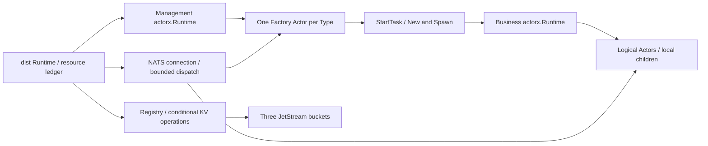

# Architecture and core integration

English | [中文](architecture.zh.md)

actorx owns local mailboxes, serial execution, tasks and complete exit. dist owns logical identity, ownership, networking and terminal evidence. The core depends only on the standard library; dist depends on core and the NATS SDK and integrates through public APIs.

## Components and resource ownership



| Component | Responsibility |
| --- | --- |
| dist Runtime | Exclusively owns the connection, execution engines, bounded work budgets and resource ledger; pure callers have no management engine |
| Factory Actor | One per declared Type; serial activation, construction deduplication and stop progress; no business key or Self |
| Registry | Ordinary Go component providing bounded KV I/O; no mailbox, object construction or second management queue |
| Business engine | Runs logical Actors and ctx.Spawn descendants; provides public Stop/Wait exit evidence |
| Management engine | Runs Factories until business exit, late handoffs, terminal submission and control work settle |

Factory handlers make short transitions. StartTask performs New/Spawn, KV I/O and exit waits using snapshots; serial completions adopt results. Runtime reserves ledger entries and work slots before scheduling. Discard fully Stop/Waits unadopted successful addresses before returning their budget.

One lifecycle monitor per generation runs independently of the Factory mailbox: it observes local Wait, removes the business subscription and submits cleanup evidence. Unexpected Factory exit immediately closes Runtime admission. The independent ledger adopts late instances and commits evidence without relying on the dead mailbox or rebuilding Factory. Failed submission retains original evidence and retries with bounded backoff in the same worker.

## Registration and context integration

Registration reads nil-receiver Bindings and retains ordinary message descriptions through Describe, never execution closures. After New, live Bindings are read once and compared with the complete registration. A private executionActor forwards the bindingSnapshot and fixed Self into ordinary Spawn.

The core provides:

```go
// package actorx
type ContextWrapper func(Context) Context
type ContextFactory func(Actor) (ContextWrapper, error)
func WithContextFactory(ContextFactory) Option
```

dist installs ContextFactory on the business engine; management keeps pure core Context. Core binds one wrapper per instance after valid Bindings and before Channel.Bind/Started. The wrapper embeds each fresh core Context and captures the owning Runtime and optional Self. It performs no I/O, business calls or repeated Bindings reads. NewRuntime and static Describe do not run the context factory.

WithContext(parent) wraps a fresh core Context with the same wrapper, retaining capability and fixed identity even with Background as the new parent. dist overrides neither Spawn nor WithContext. Local descendants gain addressing but no logical Self; see [concepts](concepts.md). Core validates retention of the current execution Context and rolls invalid wrappers back under core setup/lifecycle rules. Its partly sealed Context interface requires embedding a valid framework Context.

Public LocalChannel.Deliver/Responder capabilities reuse core admission, Deferred, completion and cancellation. dist neither accesses private execution structures nor copies local request state machines. WithInstanceLimit reserves before Bindings and releases after complete exit, so ctx.Spawn cannot bypass the business engine's instance limit.

## Activation and business paths

```mermaid
sequenceDiagram
    participant C as Caller Addr
    participant F as Factory
    participant K as Registry / KV
    participant B as Business engine
    participant N as Business subscription
    C->>K: Read candidate
    C->>F: Original Factory confirm / Activate if no current generation
    F->>K: Conditional confirmation or STARTING claim
    F-->>C: Confirmed generation; bind once
    F->>B: Runtime-owned New / Spawn
    B-->>F: Started completed
    F->>F: Business subscription + Flush
    F->>K: Conditional READY publication
    C->>N: Fixed-generation request through NATS
    N->>B: LocalChannel.Deliver / Responder
```

NewRuntime initializes execution, the connection and KV. Register validates and publishes one full contract, then installs/flushes dedicated control.* subscriptions before its shared Factory queue entry. That registration opens admission after complete readiness. Conditional KV writes grant unique creation rights; local deduplication and queue distribution do not establish ownership. Existing candidates require conditional confirmation by their original Factory; unreachable owners are not replaced. Lost claim/READY acknowledgements reconcile the original generation/operation without another New or binding an unconfirmed candidate.

NATS callbacks only validate and enqueue bounded work. Business and control dispatch are separate. Receivers validate key/generation, full fingerprint, message and mode before delivering to core mailboxes. Same-process calls follow this path too.

Activation and business replies share one lazy Runtime inbox; a second inbox handles ordered Stream consumption windows. Application subscriptions are not created per request or stream. Registry SDK requests use bounded temporary inboxes. Resolution waiters and jobs are budgeted separately; the last waiter cancellation does not release running resolution/creation work.

The complete development profile lives in the [wire resource table](contract.md#time-and-development-resource-profile). See the [Registry protocol](registry.md) for conditional ownership and PREPARED → COMMITTED evidence, [lifecycle](lifecycle.md) for shutdown order, and [deployment](deployment.md) for reconnect and maintenance.

## Shutdown and fault handoffs

Close settles internal resources in this order; application-facing guarantees live in [lifecycle](lifecycle.md#runtimeclose):

1. Stop new admission, leave shared Factory queue entries and stop new maintenance scans; retain dedicated controls and management execution.
2. Request startup cancellation, close business execution and join local descendants, adopting late New/Spawn results. Do not wait for every constructor before closing business execution.
3. Remove business subscriptions, submit generation terminal evidence and release FAILED. KV failure retains evidence/connection; blocked callbacks keep their reservations.
4. After all owned generations settle, remove dedicated controls and join entered control, maintenance, reply and stream work. Then Stop/Wait Factories, close management and finally the connection.

Each Type's control subscription spans all its instances and FAILED entries. An instance removes only its own business subscription and management entry. Slow cleanup never occupies a Factory handler; other instances can progress. The independent ledger handles unexpected Factory exit without rebuilding management.
