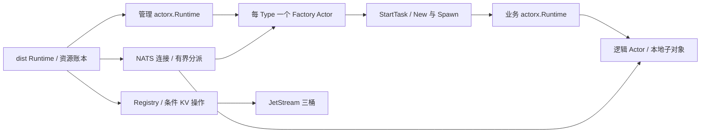
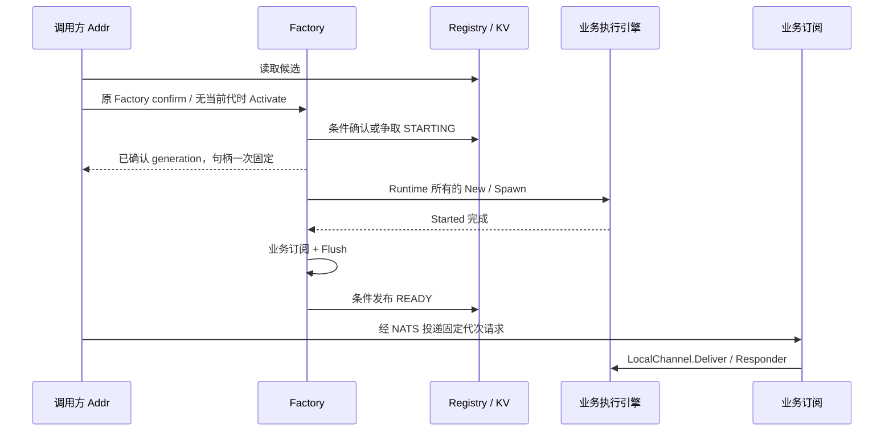

# 架构与核心接入

[English](architecture.md) | 中文

actorx 管理本地 mailbox、串行执行、任务及完整退出；dist 管理逻辑身份、归属、网络和终态证据。核心只依赖标准库，dist 单向依赖核心及 NATS SDK，使用公共 API 接入。

## 组件与资源归属



| 组件 | 责任 |
| --- | --- |
| dist Runtime | 独占连接，持有两个执行引擎、有界工作预算及资源账本；纯调用方没有管理引擎 |
| Factory Actor | 每注册 Type 一个，串行维护激活、构造去重和停止进度；没有业务 key 或 Self |
| Registry | 普通 Go 组件，封装有界 KV I/O；无 mailbox，不构造对象，不另建管理队列 |
| 业务引擎 | 执行逻辑 Actor 及 ctx.Spawn 本地后代，提供公共 Stop/Wait 退出证据 |
| 管理引擎 | 执行 Factory，保持到业务退出、迟到交接、终态及控制工作全部结清 |

Factory handler 只做短小转换；New/Spawn、KV I/O 和退出等待通过 StartTask 使用快照执行，串行完成回调接管结果。Runtime 在调度前预留账本及工作槽。未被接管的成功 Addr 经 discard 完整 Stop/Wait，才能归还预算。

每代一个生命周期监视工作独立于 Factory mailbox：观察本地 Wait、移除业务订阅，再提交清理证据。Factory 意外退出立即关闭 Runtime 新受理，独立账本接管迟到实例与提交，不依赖已死 mailbox，也不重建 Factory。提交失败保留原证据，在同一工作内有界退避重试。

## 注册与上下文接入

注册只读取具体类型 nil receiver 的 Bindings，经 Describe 保留普通消息描述，不保留执行闭包。New 后读取一次 live Bindings，与完整注册描述比较；私有 executionActor 转交 bindingSnapshot 和固定 Self，随后调用普通 Spawn。

核心提供：

```go
// package actorx
type ContextWrapper func(Context) Context
type ContextFactory func(Actor) (ContextWrapper, error)
func WithContextFactory(ContextFactory) Option
```

dist 为业务引擎安装 ContextFactory；管理引擎保持纯核心 Context。核心在有效 Bindings 后、Channel.Bind/Started 前为每实例绑定一次 wrapper。wrapper 嵌入本次新的核心 Context，捕获所属 Runtime 和可选 Self，不做 I/O、不调用业务、不再读取业务 Bindings。NewRuntime 与静态 Describe 不执行上下文工厂。

WithContext(parent) 以同一 wrapper 包装新的核心 Context；即使新 parent 为 Background，也保留能力和固定身份。dist 不覆写 Spawn/WithContext。本地后代取得寻址能力但没有逻辑 Self，详见[核心概念](concepts.zh.md)。核心校验 wrapper 保留本次执行 Context，无效包装按核心设置错误及生命周期规则回滚；半封闭 Context 接口要求嵌入有效框架 Context。

本地投递通过公共 LocalChannel.Deliver/Responder 接缝复用核心受理、Deferred、完成与取消，不访问核心执行内部结构，不复制本地请求状态机。WithInstanceLimit 在 Bindings 前预留、完整退出后释放，ctx.Spawn 不绕过业务引擎实例上限。

## 激活与业务路径



NewRuntime 初始化执行、连接和 KV；Register 校验并发布一个完整契约，先安装/Flush 该 Type 专属 control.*，再建立共享 Factory queue 入口；该次注册完整就绪后开放受理。唯一创建权由 KV 条件写入决定，本地去重和 queue 分发不授予归属。已有候选必须由原 Factory 条件确认；失联不接管。claim/READY 丢确认时核实原 generation/operation，不重新 New，不绑定未确认候选。

NATS 回调只做校验和有界排队；业务与控制分别分派。接收端核对 key/generation、完整指纹、消息及模式后，才向核心 mailbox 投递。同进程也走这条路径。

激活与业务回复共用一个延迟建立的 Runtime inbox；第二个 inbox 按序处理 Stream 消费窗口，不按请求或流新增应用订阅。Registry SDK 请求使用有界临时 inbox。解析等待者与工作分开计费，最后等待者取消不会释放仍运行的解析/创建工作。

开发配置及完整上界统一见 [wire 资源表](contract.zh.md#时间及开发资源配置)。条件归属及 PREPARED → COMMITTED 证据见 [Registry 协议](registry.zh.md)，关闭顺序见[生命周期](lifecycle.zh.md)，连接恢复及维护见[部署](deployment.zh.md)。

## 关闭与故障交接

Close 按以下顺序结清内部资源；面向应用的承诺见[生命周期](lifecycle.zh.md#runtimeclose)：

1. 关闭新受理、退出共享 Factory queue 入口并停止新维护扫描，保留专属控制与管理引擎。
2. 请求停止启动工作，关闭业务引擎并等待本地后代，接管迟到 New/Spawn 结果；不先等全部构造返回再关闭业务引擎。
3. 移除业务订阅、提交各代终态并释放 FAILED；KV 故障时保留证据和连接，未返回的回调继续占预算。
4. 全部所属代结清后移除专属控制，等待已进入的控制、维护、回复及流工作，再 Stop/Wait Factory、关闭管理引擎，最后关闭连接。

每 Type 的控制订阅跨越其全部实例和 FAILED。单实例退出只移除自己的业务订阅和管理条目，慢清理不占住 Factory handler，其他实例仍可推进。意外 Factory 退出由前述独立账本接管，不重建管理者。
