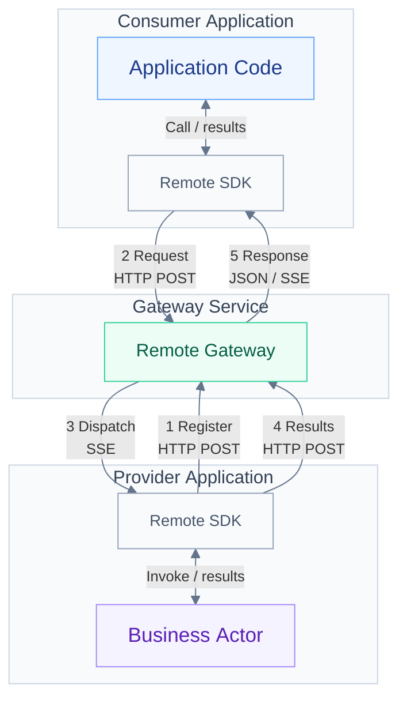

# Actorx Remote

English | [中文](README.zh.md)

Remote lets applications written in different languages call stateful Actors over HTTP. Call returns a single result; Stream delivers results incrementally. Applications need only the gateway URL and API key; the gateway is built on actorx-dist.

The implementation provides a Go gateway and Go/Python SDKs used from source. Send, WebSocket, automatic retry/reconnection and provider recovery are outside its current scope.

The directory observes Remote types across the distributed Runtime during a collection window. Both SDKs provide directory queries. Visibility does not grant cross-Gateway calling through the current ingress; see the [directory protocol](docs/protocol.md#runtimeactors-list-registered-actor-types).

## Architecture and data flow

As in the actorx-dist examples, a **consumer** calls Actors and a **provider** registers Actor types and runs business Actors. Both use the Remote SDK, and one application can serve both responsibilities. Remote adds a **gateway** that connects the two sides and uses actorx-dist for routing and activation.

The diagram's numbers match the steps below:

1. **Register**: The provider registers an Actor and keeps the registration's SSE response open.
2. **Request**: The consumer addresses that Type and an ID to initiate a Call or Stream.
3. **Dispatch**: The gateway uses actorx-dist to select the generation, creates the provider's business object on first use, then dispatches the operation.
4. **Execute**: The provider runs the business logic and POSTs results or chunks back to the gateway.
5. **Return**: The gateway returns JSON for Call, or chunks followed by a terminal result/error over SSE for Stream.

Additional notes:

- Arrows show message direction. Both sides initiate connections to the gateway; the provider receives calls over its existing registration SSE connection and needs no inbound listener.
- Stream consumption acknowledgments and cancellation pass through the gateway and are omitted from the diagram.

## Run an example

Start with Counter, then try Chat for incremental replies. Each example includes setup, process commands, expected output and an explanation of the code.

| Example | What you will learn |
| --- | --- |
| [Counter](examples/counter/README.md) | Register a Go or Python provider, increment a counter through Call, and observe retained totals and independent state by ID. |
| [Chat](examples/chat/README.md) | Call and consume a Stream incrementally on the same Actor. |

## Guides and reference

After running an example, use the SDK guide to write your own provider or consumer. Consult the other documents for execution semantics and wire details as needed.

| Guide | Contents |
| --- | --- |
| [Go SDK](sdk/go/README.md) | Independent module, provider/consumer APIs, contexts, errors and explicit cleanup. |
| [Python SDK](sdk/python/README.md) | Installation, provider and consumer APIs, types, exceptions and Stream usage. |
| [Runtime and lifecycle](docs/runtime.md) | Activation, fixed generations, deadlines, concurrency, Go embedding and cleanup ownership. |
| [Protocol](docs/protocol.md) | Call/Stream methods and exchanges, HTTP/SSE, flow control, cancellation, errors and limits. |

Maintainers: see [Development and releases](docs/development.md).
