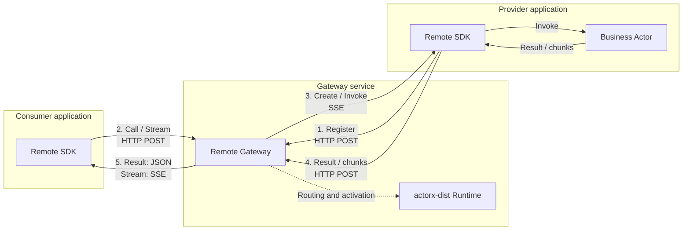

# Actorx Remote

English | [中文](README.zh.md)

Remote lets applications written in different languages call stateful Actors over HTTP. Call returns a single result; Stream delivers results incrementally. Applications need only the gateway URL and API key; the gateway is built on actorx-dist.

The implementation provides a Go gateway and a Python SDK installed from source. Send, WebSocket, automatic retry/reconnection and provider recovery are outside its current scope.

## Architecture and data flow

A consumer application uses the Remote SDK to make Calls or consume Streams. A provider application uses the SDK to register Actor Types and run business Actors. The gateway connects the two sides and routes their messages.

Data flow:

1. **Register**: The provider registers an Actor Type and keeps the registration's SSE response open.
2. **Request**: The consumer addresses that Type and an ID to initiate a Call or Stream.
3. **Dispatch**: The gateway uses actorx-dist to select the generation, creates the provider's business object on first use, then dispatches the operation.
4. **Execute**: The provider runs the business logic and POSTs results or chunks back to the gateway.
5. **Return**: The gateway returns JSON for Call, or chunks followed by a terminal result/error over SSE for Stream.

Additional notes:

- Solid arrows show message direction. Both sides initiate connections to the gateway; the provider receives calls over its existing registration SSE connection and needs no inbound listener.
- Stream consumption acknowledgments and cancellation pass through the gateway and are omitted from the diagram.

## Run an example

Start with Ping/Pong, then try Chat for incremental replies. Each example includes setup, process commands, expected output and an explanation of the code.

| Example | What you will learn |
| --- | --- |
| [Ping/Pong](examples/pingpong/README.md) | Register a provider, make Calls from a separate consumer, and observe instance reuse and independent state by ID. |
| [Chat](examples/chat/README.md) | Consume a Stream incrementally and observe backpressure with a slow consumer. |

## Guides and reference

After running an example, use the SDK guide to write your own provider or consumer. Consult the other documents for execution semantics and wire details as needed.

| Guide | Contents |
| --- | --- |
| [Python SDK](sdk/python/README.md) | Installation, provider and consumer APIs, types, exceptions and Stream usage. |
| [Runtime and lifecycle](docs/runtime.md) | Activation, fixed generations, deadlines, concurrency, Go embedding and cleanup ownership. |
| [Protocol](docs/protocol.md) | Call/Stream methods and exchanges, HTTP/SSE, flow control, cancellation, errors and limits. |
