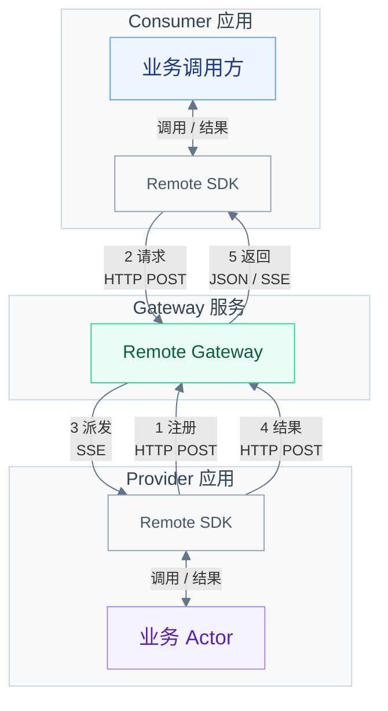

# Actorx Remote

[English](README.md) | 中文

Remote 让不同语言编写的应用通过 HTTP 调用有状态 Actor：Call 一次返回结果，Stream 逐段返回结果。应用只需 gateway URL 与 API Key，gateway 基于 actorx-dist 构建。

当前提供 Go gateway 与从源码安装的 Python SDK。Send、WebSocket、自动重试/重连和 provider 恢复不在当前实现范围内。

## 架构与数据流

Consumer 应用中的业务代码通过 Remote SDK 发起 Call 或消费 Stream；provider 应用通过 SDK 注册 Actor 并运行自己的业务 Actor。Gateway 连接两端，通过 actorx-dist 完成路由与激活。

图中编号对应以下步骤：

1. **注册**：Provider 注册 Actor，并保持注册请求的 SSE 响应连接。
2. **请求**：Consumer 按 Type 和 ID 寻址，发起 Call 或 Stream。
3. **派发**：Gateway 通过 actorx-dist 选定代次，首次使用时在 provider 中创建业务对象，再发送调用。
4. **执行**：Provider 执行业务，将结果或分片 POST 回 gateway。
5. **返回**：Gateway 为 Call 返回 JSON，为 Stream 通过 SSE 返回分片及最终结果或错误。

补充说明：

- 箭头表示消息方向。两端都主动连接 gateway；provider 沿已建立的注册 SSE 连接接收调用，无需监听入站端口。
- Stream 的消费确认与取消也经由 gateway 转发，图中省略了这两类控制流。

## 运行示例

建议先运行 Counter，再用 Chat 体验流式回复。每个示例都包含环境准备、进程启动命令、预期输出和代码解释。

| 示例 | 学习内容 |
| --- | --- |
| [Counter](examples/counter/README.zh.md) | 注册 Python provider，通过 Call 累加计数，观察状态保留与不同 ID 的独立状态。 |
| [Chat](examples/chat/README.zh.md) | 逐段消费 Stream，通过慢消费观察背压。 |

## 使用指南与参考

跑通示例后，通过 SDK 指南编写自己的 provider 或 consumer，再按需查阅运行语义和 wire 细节。

| 文档 | 内容 |
| --- | --- |
| [Python SDK](sdk/python/README.zh.md) | 安装、provider 与 consumer API、类型、异常及 Stream 用法。 |
| [运行模型与生命周期](docs/runtime.zh.md) | 激活、固定代次、期限、并发、Go 接入和清理责任。 |
| [协议](docs/protocol.zh.md) | Call/Stream 方法与消息过程、HTTP/SSE、流控、取消、错误及限制。 |
