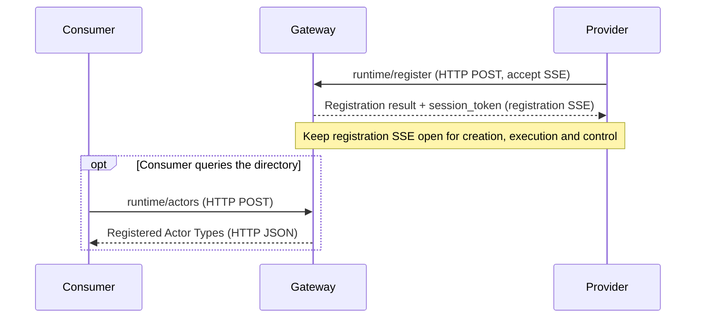
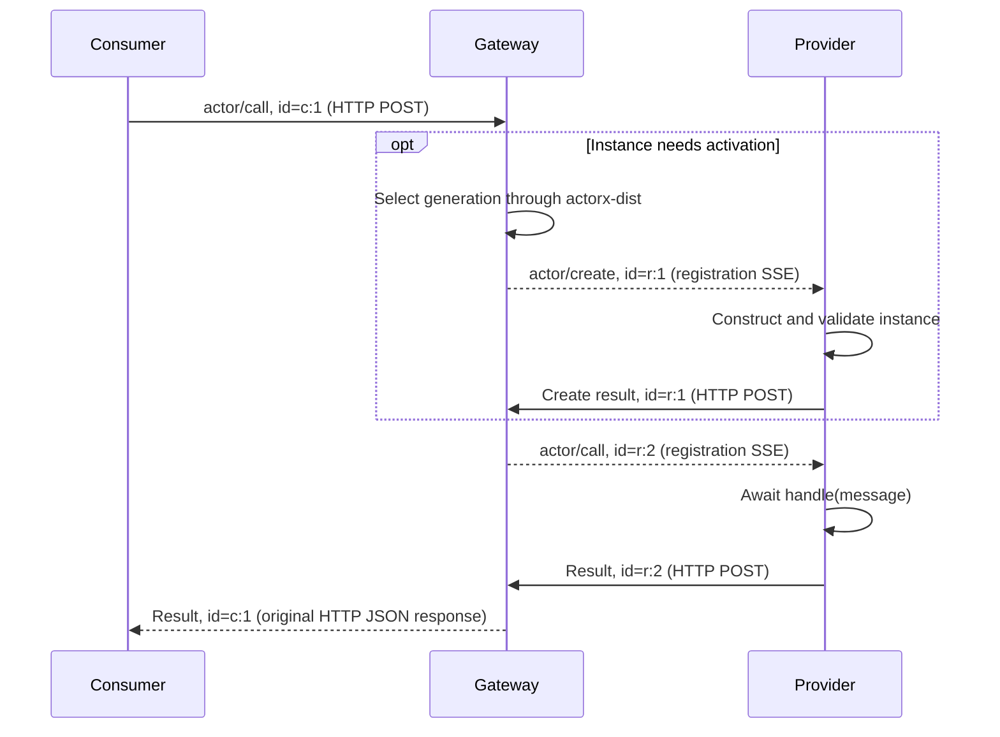
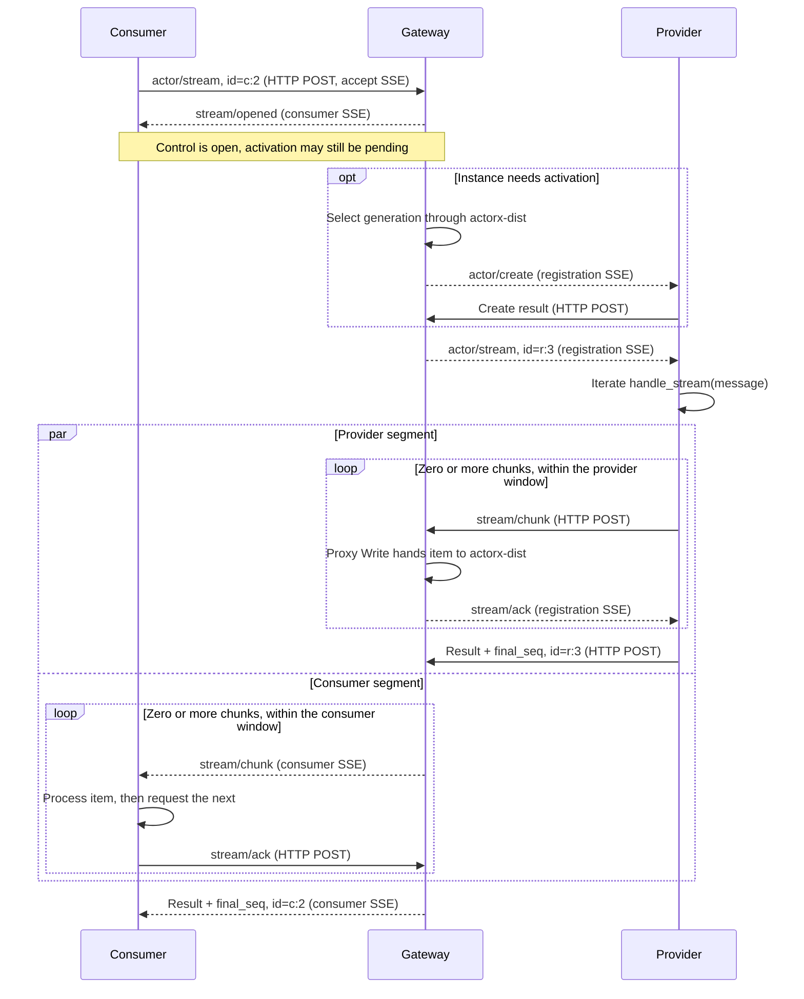
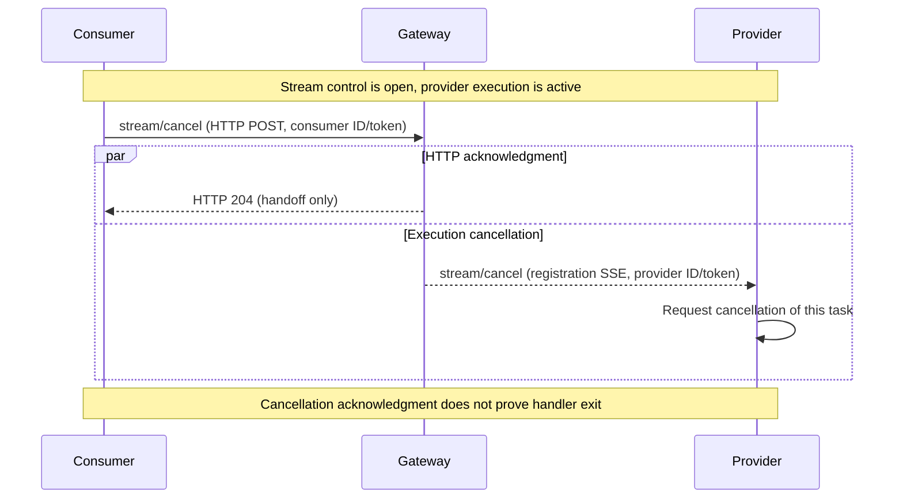

# Remote protocol

English | [中文](protocol.zh.md)

`actorx.remote/v1` connects consumers, a gateway and providers over HTTP/SSE. This is the complete wire reference for Call and Stream. The Go and Python SDKs manage encoding, version headers, flow control and response correlation. For a first run, start with [Counter](../examples/counter/README.md) or [Chat](../examples/chat/README.md), then the [SDK guide](../sdk/python/README.md).

## Shared model

Providers register Actors. Each instance has one Type/ID/generation identity and one lifetime; Call and Stream are its two operations.

| | Call | Stream |
| --- | --- | --- |
| Consumer API | `await addr.call(message)` | `async with addr.stream(message) as chunks` |
| Provider method | `handle(message)` returns an awaitable producing one JSON value | `handle_stream(message)` directly returns an async iterator |
| Business output | One JSON value | Zero or more JSON items and an explicit terminal |
| Consumer response | HTTP JSON | HTTP SSE |

Objects may implement either method or both; the operations share state and execute serially. Missing methods produce 1013; exceptions or invalid return shapes after method entry produce 1000. The SDK does not convert operations.

Both sides initiate connections to the gateway. Providers keep a registration SSE connection for creation, execution and stream control, posting results or chunks separately. They need no inbound listener.

Flows and messages: [registration and discovery](#registration-and-discovery), [Call](#call-exchange), [Stream](#stream-exchange), and [early cancellation](#streamcancel-cancel-early). Diagrams omit provider POST session headers and HTTP 204 handoff acknowledgments unless shown explicitly.

## Transport and messages

### HTTP and authentication

All messages use `POST /runtime/rpc` with:

```http
Authorization: Bearer <api-key>
Content-Type: application/json
X-Actorx-Remote-Protocol: actorx.remote/v1
```

The SDK sends the version header automatically and validates registration results. After authentication, before body reads or dispatch, the gateway requires exactly one matching version header; missing, mismatched, empty or ambiguous values return HTTP 400.

| POST content | Additional header | Normal response |
| --- | --- | --- |
| `runtime/register` | `Accept: text/event-stream, application/json` | 200 SSE: registration result, then that registration's creation, execution and credit/cancel messages |
| `actor/stream` | Same as above | 200 SSE: stream/opened, chunks, final result/error |
| Call, Actor directory, ordinary request batch | `Accept: application/json` | 200 JSON result/error or response array |
| Provider result, error or chunk | `X-Actorx-Remote-Session: <session_token>` | 204 after validation and handoff |
| Consumer credit/cancel | No session header; one notification per POST | 204 after validation and handoff |

Registration and Stream consumption require a **single request with an ID** accepting SSE. Batches/notifications never establish streams: requests with IDs receive 1008; notifications produce no RPC response. Business rejection before SSE establishment uses 200 JSON RPC error, so clients should also accept JSON. An unacceptable response format returns 406.

Each SSE frame is `data: <one single-line JSON-RPC message>` followed by a blank line and immediately flushed. SSE event/id do not replace RPC method/id. **HTTP 200, POST 204 and SSE EOF never imply business success**; 204 acknowledges only the handoff.

Every POST checks the shared static API key before reading its body, looking up sessions or doing Actor work. There are no consumer/provider roles, Type ACLs or tenant isolation. A missing key returns 401 with `WWW-Authenticate: Bearer realm="actorx-remote"`; invalid keys add `error="invalid_token"`. Duplicate/ambiguous Authorization is rejected; key comparison is constant-time.

Configure a key generated from at least 32 random bytes through a trusted environment; keep keys/tokens out of URLs and logs. Beyond the loopback demo, use HTTPS with certificate validation and protect the link after TLS termination. The SDK does not follow redirects. A `session_token` associates one registration; it is not an access credential or an idempotency key. Provider uploads require the session header; other requests/notifications must omit it.

### JSON-RPC

Envelopes use JSON-RPC `2.0`. Requests contain `method`, object `params` and `id`; notifications omit `id`. Responses echo the ID and contain exactly one of `result` or `error`, including `result: null`. The Actor directory permits omitted params. Methods match complete slash-separated names without dot aliases; unknown methods or wrong directions produce -32601.

Consumer/SDK-generated IDs are nonempty strings. Consumer requests also accept numeric and null IDs, preserving their type and precision. `id: null` is a request with an ID. IDs correlate one communication segment; they provide no business deduplication. Provider responses must also match the registration and complete address. Bad or late responses cannot consume a legitimate pending request.

Gateway → provider request IDs use `r:<n>`, with n a decimal integer from 1 to 2^53−1 without leading zeros. Each registration session has one counter for create/call/stream, starting at 1 and increasing in enqueue order; gaps and out-of-order completion are allowed. The provider stores only the largest received sequence; invalid, repeated or decreasing IDs are protocol errors that end the session. Exhaustion rejects new requests without wrapping. Notifications do not advance the counter; stream controls reference the original request_id.

The Gateway replica holding registration SSE owns the session and keeps registrations, pending requests and stream state in memory; related POSTs must reach that replica. New registrations use new session_tokens and restart their counters; replicas need no shared counter.

JSON must be UTF-8 without duplicate keys or NaN/Infinity. Unknown envelope fields are ignored; unknown method parameters are rejected (-32602). Business `input`/`value` are required but may be null; their contents are application-defined. Numbers are not rounded at the boundary.

Ordinary request batches contain at most eight items and execute sequentially within one HTTP budget, without transaction semantics. Notifications have no response; an all-notification document returns 204. Empty batches/invalid elements follow JSON-RPC error rules. Provider responses, chunks and stream controls use individual POSTs; a provider response embedded in a batch rejects the whole document before dispatch. The Go and Python SDKs have no batch API.

## Identity, registration and methods

```json
{
  "version": 1,
  "type": "demo.chat",
  "id": "session-42",
  "generation": "AAAAAAAAAAAAAAAAAAAAAA"
}
```

`type` identifies an Actor type and `id` a business instance. The first `actor/call` or `actor/stream` may omit generation; the gateway selects it through actorx-dist. A generation is a canonical unpadded base64url encoding of 16 bytes. Provider creation/execution messages require complete addresses.

The SDK saves generation from a successful result, valid error address or first Stream item. Later operations remain fixed to it, without automatic replacement on error. stream/opened has no address and only establishes control; empty streams supply the address in their terminal. A possibly accepted request without trustworthy generation evidence leaves the handle uncertain; later operations raise `AddressUncertainError`. A fresh handle does not deduplicate earlier work. Authentication/parameter rejection and definite connection-establishment failure do not contaminate the handle.

All methods appear below. Params are required unless marked optional; a fixed address includes generation. `window` is always `{"items":4,"bytes":32768}`.

| Method | Message | Params | Successful result |
| --- | --- | --- | --- |
| `runtime/register` | Request | type; optional description, default empty | protocol, type, session_token |
| `runtime/actors` | Request | Empty object, may be omitted | actors: array of objects with type, description, protocol |
| `actor/call` | Request | address, input; optional deadline_unix_ms | Fixed address, value |
| `actor/create` | Request | Fixed address, deadline_unix_ms | Same address |
| `actor/stream` | Request | Common Call fields; provider requests also require stream_token, window | Fixed address, final_seq |
| `stream/opened` | Notification | request_id, stream_token, window | None |
| `stream/chunk` | Notification | request_id, stream_token, fixed address, seq, value | None |
| `stream/ack` | Notification | request_id, stream_token, ack_seq | None |
| `stream/cancel` | Notification | request_id, stream_token | None |

The gateway selects generation when needed and forwards the fixed address and established absolute deadline using an independent request ID. Provider Call/Stream requests require generation and an explicit deadline; Stream also requires a preinstalled `stream_token` and `window`. Consumer requests reject those control fields and may omit generation/deadline.

JSON below is indented for readability; each actual SSE message occupies one line. Addresses, tokens and deadlines are illustrative and selected or calculated at runtime.

## Registration and discovery

The provider registers its Type and keeps the returned SSE open, using the session token for subsequent POSTs. Consumers may query the directory; discovery is optional before Call/Stream.



Registration establishes only a session: it neither constructs instances, probes methods nor guarantees creation success. The first Call/Stream creates an instance on demand.

The directory is a registration snapshot, not a running-instance list, capacity reservation or availability guarantee; its protocol field does not promise method support.

v1 registration params/results and Actor entries have no `capabilities`. Removed registration params are rejected even when false, null or empty; the SDK also rejects results containing that field.

### runtime/register: register an Actor

Provider → gateway, one HTTP POST accepting SSE:

```json
{
  "jsonrpc": "2.0",
  "id": "p:1",
  "method": "runtime/register",
  "params": {
    "type": "demo.chat"
  }
}
```

Gateway → provider, the first registration SSE frame returns protocol, Type and the session token:

```json
{
  "jsonrpc": "2.0",
  "id": "p:1",
  "result": {
    "protocol": "actorx.remote/v1",
    "type": "demo.chat",
    "session_token": "<session_token>"
  }
}
```

### runtime/actors: list registered Actor types

Consumer → gateway, an ordinary HTTP POST; `params` may be omitted or `{}`:

```json
{
  "jsonrpc": "2.0",
  "id": "list:1",
  "method": "runtime/actors"
}
```

The gateway returns a list of registered Remote Actor types in the HTTP response:

```json
{
  "jsonrpc": "2.0",
  "id": "list:1",
  "result": {
    "actors": [
      {
        "type": "demo.chat",
        "description": "Chat provider",
        "protocol": "actorx.remote/v1"
      }
    ]
  }
}
```

Each Type appears once, and the list is sorted by Type. If providers of the same Type supply different descriptions, `description` is empty.

The list may be incomplete. Listing a Type does not guarantee a later call will succeed. Cross-Gateway calls are not yet supported.

If discovery limits prevent returning the full list, the query returns 1001/full. A complete response exceeding 8 KiB returns HTTP 413. Errors return no partial list.

## Call exchange

The consumer starts a Call and awaits its original HTTP response. When activation is needed, the gateway selects generation and creates the instance before invocation.



Ready instances skip `actor/create`; creation failure prevents invocation. First Stream activation uses the same method.

### actor/call: start a Call

Consumer → gateway, an ordinary HTTP POST; this example omits generation:

```json
{
  "jsonrpc": "2.0",
  "id": "c:1",
  "method": "actor/call",
  "params": {
    "address": {
      "version": 1,
      "type": "demo.chat",
      "id": "session-42"
    },
    "input": {
      "text": "hello"
    }
  }
}
```

### actor/create: create on demand

Gateway → provider, over existing registration SSE, with the selected complete address and creation deadline:

```json
{
  "jsonrpc": "2.0",
  "id": "r:1",
  "method": "actor/create",
  "params": {
    "address": {
      "version": 1,
      "type": "demo.chat",
      "id": "session-42",
      "generation": "AAAAAAAAAAAAAAAAAAAAAA"
    },
    "deadline_unix_ms": 1890000000000
  }
}
```

The provider constructs and validates the actual object, then answers by HTTP POST. Repeated create for the same complete identity reuses the object:

```json
{
  "jsonrpc": "2.0",
  "id": "r:1",
  "result": {
    "address": {
      "version": 1,
      "type": "demo.chat",
      "id": "session-42",
      "generation": "AAAAAAAAAAAAAAAAAAAAAA"
    }
  }
}
```

### actor/call: execute the Call

Gateway → provider, over registration SSE, with input, the fixed address and remaining deadline:

```json
{
  "jsonrpc": "2.0",
  "id": "r:2",
  "method": "actor/call",
  "params": {
    "address": {
      "version": 1,
      "type": "demo.chat",
      "id": "session-42",
      "generation": "AAAAAAAAAAAAAAAAAAAAAA"
    },
    "input": {
      "text": "hello"
    },
    "deadline_unix_ms": 1890000000000
  }
}
```

The provider calls `handle(message)`, awaits one JSON value and returns it by HTTP POST:

```json
{
  "jsonrpc": "2.0",
  "id": "r:2",
  "result": {
    "address": {
      "version": 1,
      "type": "demo.chat",
      "id": "session-42",
      "generation": "AAAAAAAAAAAAAAAAAAAAAA"
    },
    "value": {
      "text": "complete answer"
    }
  }
}
```

The gateway returns the same `result` on the original HTTP response with the consumer ID, `"c:1"`.

Call success proves this handler returned, without guaranteeing that additional background work finished. Business failures return `error`; see [errors](#errors).

## Stream exchange

The consumer opens a Stream over SSE. The gateway establishes control, activates the instance if needed, then invokes it. The method examples use a one-item Stream with an already selected generation.



Each Stream produces zero or more chunks and one terminal result/error answering the original request. The two segments progress independently; see [flow control and terminal results](#flow-control-and-terminal-results) for completion rules.

The gateway maps independent RPC IDs, stream tokens, sequences and credit ledgers for both segments. Stream tokens encode 32 random bytes as canonical unpadded base64url. Consumers receive neither the provider session token nor its stream token. Example values:

| Segment | Original request ID | stream_token |
| --- | --- | --- |
| consumer ↔ gateway | `c:2` | `AAAAAAAAAAAAAAAAAAAAAAAAAAAAAAAAAAAAAAAAAAA` |
| gateway ↔ provider | `r:3` | `AQEBAQEBAQEBAQEBAQEBAQEBAQEBAQEBAQEBAQEBAQE` |

### actor/stream: start a Stream

Consumer → gateway, one HTTP POST accepting SSE; params have the same shape as Call:

```json
{
  "jsonrpc": "2.0",
  "id": "c:2",
  "method": "actor/stream",
  "params": {
    "address": {
      "version": 1,
      "type": "demo.chat",
      "id": "session-42",
      "generation": "AAAAAAAAAAAAAAAAAAAAAA"
    },
    "input": {
      "text": "hello"
    }
  }
}
```

### stream/opened: establish control

Gateway → consumer, the first notification on the request SSE, supplying its consumer token and fixed window:

```json
{
  "jsonrpc": "2.0",
  "method": "stream/opened",
  "params": {
    "request_id": "c:2",
    "stream_token": "AAAAAAAAAAAAAAAAAAAAAAAAAAAAAAAAAAAAAAAAAAA",
    "window": {
      "items": 4,
      "bytes": 32768
    }
  }
}
```

It contains no address and proves neither activation nor execution success; initial generation selection may still be pending.

### actor/stream: execute the Stream

Gateway → provider, over registration SSE, using a separate RPC ID and provider token, complete address and deadline:

```json
{
  "jsonrpc": "2.0",
  "id": "r:3",
  "method": "actor/stream",
  "params": {
    "address": {
      "version": 1,
      "type": "demo.chat",
      "id": "session-42",
      "generation": "AAAAAAAAAAAAAAAAAAAAAA"
    },
    "input": {
      "text": "hello"
    },
    "deadline_unix_ms": 1890000000000,
    "stream_token": "AQEBAQEBAQEBAQEBAQEBAQEBAQEBAQEBAQEBAQEBAQE",
    "window": {
      "items": 4,
      "bytes": 32768
    }
  }
}
```

The provider calls `handle_stream(message)` and iterates its output. Creation, execution and control messages for different instances may interleave on one registration SSE.

### stream/chunk: send an item

Provider → gateway, one notification POST with the session header; `request_id` references the provider execution request:

```json
{
  "jsonrpc": "2.0",
  "method": "stream/chunk",
  "params": {
    "request_id": "r:3",
    "stream_token": "AQEBAQEBAQEBAQEBAQEBAQEBAQEBAQEBAQEBAQEBAQE",
    "address": {
      "version": 1,
      "type": "demo.chat",
      "id": "session-42",
      "generation": "AAAAAAAAAAAAAAAAAAAAAA"
    },
    "seq": 1,
    "value": {
      "text": "first fragment"
    }
  }
}
```

After validation, the gateway forwards the same value over consumer SSE with the consumer ID/token and an independent sequence; both sequences are 1 here.

### stream/ack: acknowledge consumption

Consumer → gateway, one notification POST without a session header:

```json
{
  "jsonrpc": "2.0",
  "method": "stream/ack",
  "params": {
    "request_id": "c:2",
    "stream_token": "AAAAAAAAAAAAAAAAAAAAAAAAAAAAAAAAAAAAAAAAAAA",
    "ack_seq": 1
  }
}
```

Gateway → provider ack uses the provider ID/token over registration SSE. The segments acknowledge independently; see [flow control and terminal results](#flow-control-and-terminal-results) for timing.

### Terminal response: finish the Stream

When iteration ends normally, the provider answers `actor/stream` by POST with the session header. A terminal is a response, with no method:

```json
{
  "jsonrpc": "2.0",
  "id": "r:3",
  "result": {
    "address": {
      "version": 1,
      "type": "demo.chat",
      "id": "session-42",
      "generation": "AAAAAAAAAAAAAAAAAAAAAA"
    },
    "final_seq": 1
  }
}
```

After the consumer acknowledges all items in its segment, the gateway sends a success response with ID `"c:2"` over the original SSE; its `result` is the same in this example.

See [flow control and terminal results](#flow-control-and-terminal-results) for empty streams, partial failures and completion rules.

### stream/cancel: cancel early

Once control is open, the consumer can request cancellation of this execution:



Cancellation affects one Stream, preserving the shared Actor/registration. HTTP 204 and cancellation propagation are independent and neither proves handler exit; late cancellation preserves a known terminal. The original Stream settles under the [terminal and error rules](#flow-control-and-terminal-results).

Consumer → gateway, one notification POST without a session header:

```json
{
  "jsonrpc": "2.0",
  "method": "stream/cancel",
  "params": {
    "request_id": "c:2",
    "stream_token": "AAAAAAAAAAAAAAAAAAAAAAAAAAAAAAAAAAAAAAAAAAA"
  }
}
```

The gateway forwards cancellation over registration SSE using the provider ID/token.

### Flow control and terminal results

`request_id` references the segment's original ID, preserving string/number/null type. `seq` starts at 1 and is contiguous up to 2^53−1; `ack_seq` and `final_seq` range from 0 to 2^53−1. Chunk and terminal addresses must match the fixed identity.

Each segment has a fixed four-item/32 KiB window with no alternatives negotiated. Count actual UTF-8 bytes of complete JSON-RPC chunks, excluding SSE wrapping; queued and processing items remain charged. Cumulative ack_seq releases only consecutive entries in that segment's ledger. Duplicate/backward credits grant no extra allowance; forward credits are rejected.

| Segment | When credit is sent |
| --- | --- |
| Provider → gateway | After the proxy's StreamReply.Write hands off into the bounded actorx-dist Stream |
| Gateway → consumer | After user processing, when iteration requests the next item |

Provider credit does not prove final consumer consumption. The gateway callback waits for consumer credit before returning, propagating slow consumption through actorx-dist's window. Upload POSTs perform bounded handoff without waiting for the entire chain; the provider must receive each POST's 204 before sending its next item or terminal. That 204 does not replace credit.

Control and terminal messages use bounded reserves outside the data window. After the last item, iteration must request the next item to acknowledge it before waiting for completion.

Three completion facts are assessed separately:

- **Success terminal**: `final_seq: N` means this segment normally produced N items and will send no further chunks; N=0 is a valid empty stream. The terminal may arrive before all acknowledgments.
- **Local success**: a valid success terminal has been checked and all N consecutive items have completed local delivery (application consumption or bounded handoff), without skipping queued items. Local consumption failure remains a local failure without erasing the confirmed production outcome.
- **Ledger reclamation**: the sender retains its unacknowledged ledger until all acknowledgments, the original deadline or connection/session closure.

Errors carry known address and that segment's final_seq in data; they may discard queued items awaiting local delivery, without rolling back output already delivered to users.

Missing terminal, disconnection, missing items or sequence/identity contradictions produce 1004 `outcome_unknown` when work may have executed. Last-credit transport failure does not rewrite validated success once local delivery is complete.

## Deadlines and cancellation

`deadline_unix_ms` is an integer UTC Unix millisecond timestamp. Omission differs from zero, which is already expired. Stages use the remaining budget; responses and retries do not start a new one.

| Operation | Budget |
| --- | --- |
| Call | Default five seconds, capped by explicit deadline and parent context; an explicit value cannot extend the five-second limit |
| Stream | Default five seconds; explicit deadline up to 60 seconds from entry, capped by parent context |
| Shared activation create | Independent three-second cap, bounded by lifecycle deadline |
| Registration | Five-second installation budget; a successful connection becomes long-lived |
| SSE frame write | At most five seconds per frame; Stream also respects its total deadline |

Python Stream `timeout` accepts (0, 60] seconds and uses a monotonic clock for waits. Chunks/credits do not renew it. Expiry before handler start produces 1005; expiry after start without trustworthy terminal evidence produces 1004.

Call has no remote cancellation method. The SDK retains instance locks and execution slots until user tasks exit, preventing overlap on the same instance. Timeout, cancellation or disconnect do not prove external side effects have ended.

Python consumers should use `async with` and `async for`. An early break must leave the context or explicitly `await chunks.aclose()`; Runtime shutdown also owns cleanup. Provider disconnection withdraws its registration and wakes pending requests without automatic recovery. See [runtime ownership and shutdown](runtime.md#disconnect-and-shutdown).

## Errors

### HTTP rejections

| Status | Meaning |
| --- | --- |
| 400 | Invalid/ambiguous protocol or session header; malformed provider message or stream control |
| 401 | Missing, invalid or ambiguous API key |
| 403 | Invalid/closed session or stream token; provider upload without session header |
| 405 | Method other than POST |
| 406 | Unacceptable response format |
| 409 | Unknown/settled request, correlation/address mismatch or forward credit |
| 413 | Body, batch item count or encoded response limit exceeded |
| 415 | Content-Type is not application/json |

These return HTTP status without RPC error. Invalid request JSON, RPC envelopes and business failures use the RPC errors below. Business errors remain HTTP 200 JSON or SSE terminals, without becoming 502/504. SSE setup may return 500 when write deadlines are unavailable.

### RPC errors

Standard errors are -32700 `parse_error`, -32600 `invalid_request`, -32601 `method_not_found`, -32602 `invalid_params` and -32603 `internal_error`. Application errors are:

| Code | error.data.kind | Meaning |
| --- | --- | --- |
| 1000 | remote_error | Instance creation failure, handler exception, no valid methods or invalid return shape |
| 1001 | full | Definite capacity rejection |
| 1002 | actor_unavailable | Valid address cannot be resolved or no target is available; business handler not entered |
| 1003 | activation_unknown | Uncertain activation or generation selection |
| 1004 | outcome_unknown | Work may have executed without trustworthy terminal evidence |
| 1005 | deadline_exceeded | Definite deadline failure |
| 1006 | stopped | Definite stopped/closed failure |
| 1007 | registration_conflict | Same Type registered or closing locally |
| 1008 | transport_mode | Channel cannot meet single-request, SSE or control-context establishment prerequisites |
| 1009 | canceled | Cancellation without an uncertainty classification |
| 1010 | owner_unavailable | actorx-dist owner unreachable; no automatic takeover |
| 1011 | contract | actorx-dist DTO/Type contract mismatch |
| 1012 | protocol | Internal protocol/wiring failure |
| 1013 | unsupported_operation | Instance lacks a callable method for the requested operation |

Errors echo the original request ID, or null when unknown. Application errors contain `data.kind` and, when known, complete `data.address`. Stream errors also carry that segment's `final_seq`:

```json
{
  "jsonrpc": "2.0",
  "id": "c:2",
  "error": {
    "code": 1013,
    "message": "unsupported_operation",
    "data": {
      "kind": "unsupported_operation",
      "address": {
        "version": 1,
        "type": "demo.chat",
        "id": "session-42",
        "generation": "AAAAAAAAAAAAAAAAAAAAAA"
      },
      "final_seq": 0
    }
  }
}
```

1013 requires a complete address and, for Stream, zero items with `final_seq: 0`. It proves the requested method was not entered, although construction may have occurred. Python raises `UnsupportedOperationError` and saves generation so the same Addr can use a supported operation. Missing address or contradictory terminal evidence produces 1004.

Invalid parameter structure or values use -32602; 1002/1008 reject valid requests before handler entry because of address/channel limitations. On an established Stream, these rejections require no chunks and `final_seq: 0`; JSON rejections before establishment may omit final_seq. Contradictory terminal evidence produces 1004.

Validated provider errors 1000/1001/1002/1004/1005/1008/1009/1013 retain classification; other legal application errors normalize to 1000. Standard RPC errors for known outbound methods become 1012. Known kind/code pairs must agree. Exception types, stack traces and arbitrary provider extensions do not cross actorx-dist; diagnostics are bounded to 512 UTF-8 bytes.

Definite provider failure takes priority over later stop/cancel. Without a definite terminal, classification follows outcome_unknown → activation_unknown → specific framework errors. Local consumption exceptions remain local failures.

## Limits and compatibility

| Item | Limit |
| --- | --- |
| Request body / individual encoded message, including envelope | 8 KiB |
| Request batch | Eight items; body still limited to 8 KiB |
| Encoded batch response | 64 KiB |
| JSON nesting | 64 levels |
| Unacknowledged chunks per segment | Four items / 32 KiB |

The current unpublished `actorx.remote/v1` includes incompatible updates; upgrade the gateway and SDKs together. Stream messages use `stream/opened`, `stream/chunk`, `stream/ack` and `stream/cancel`; the former `actor/stream_open`, `actor/chunk`, `actor/credit` and `actor/cancel` names are not accepted as wire aliases. Renaming these methods does not change their bodies, flow control, cancellation or HTTP status handling.

See [runtime limits](runtime.md#resource-limits) for execution capacity, object counts and queues. address.version=1, jsonrpc="2.0" and actorx.remote/v1 describe independent layers. v1 always provides both communication operations without capability negotiation; the SDK removes the old `stream=True` argument. Upgrading gateway/SDK does not erase published actorx-dist Type contracts; see [Type migration](runtime.md#protocol-and-type-migration). Send, WebSocket, automatic reconnect/retry and resume remain unimplemented.

Implementation references: [base DTOs](../protocol/messages.go), [Stream DTOs](../protocol/stream.go), [envelope/method validation](../protocol/rpc.go) and [HTTP binding](../http/handler.go). Go/Python share [fixed v1 vectors](../protocol/testdata/v1.json); internal DTOs and proxy wiring are documented in the [runtime guide](runtime.md#go-bridge).

- [Go SDK](../sdk/go/README.md) / [Python SDK](../sdk/python/README.md)
