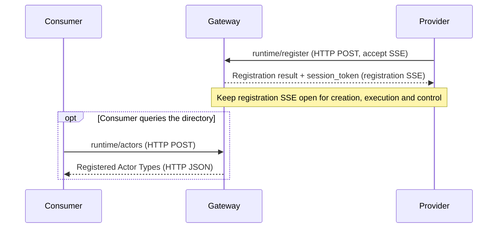
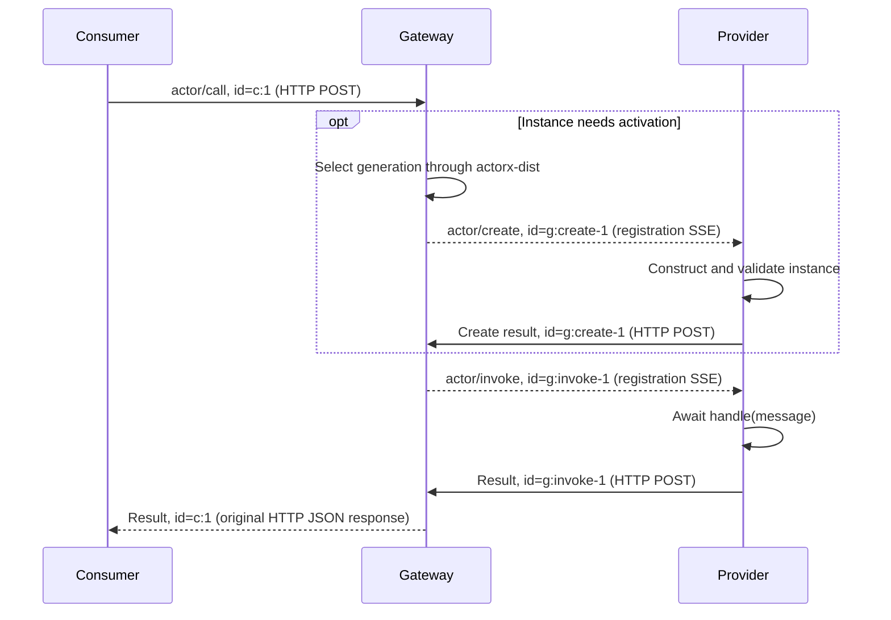
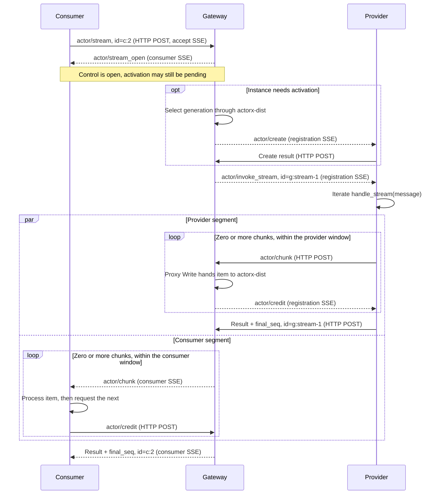

# Remote protocol

English | [中文](protocol.zh.md)

`actorx.remote/v1` connects consumers, a gateway and providers over HTTP/SSE. This is the complete wire reference for Call and Stream. The Python SDK manages encoding, version headers, flow control and response correlation. For a first run, start with [Counter](../examples/counter/README.md) or [Chat](../examples/chat/README.md), then the [SDK guide](../sdk/python/README.md).

## Shared model

Providers register Actors. Each instance has one Type/ID/generation identity and one lifetime; Call and Stream are its two operations.

| | Call | Stream |
| --- | --- | --- |
| Consumer API | `await addr.call(message)` | `async with addr.stream(message) as chunks` |
| Provider method | `handle(message)` returns an awaitable producing one JSON value | `handle_stream(message)` directly returns an async iterator |
| Business output | One JSON value | Zero or more JSON items and an explicit terminal |
| Consumer response | HTTP JSON | HTTP SSE |

An object may implement either method or both; the operations share instance state and execute serially. Registration neither probes nor constructs objects; first activation creates them. A missing requested method produces 1013; exceptions or invalid return shapes after method entry produce 1000. The SDK never converts one operation into the other.

Both sides initiate connections to the gateway. Providers keep a registration SSE connection for creation, execution and stream control, posting results or chunks separately. They need no inbound listener.

Each stage starts with an overview sequence diagram, followed by method definitions and JSON examples: [registration and discovery](#registration-and-discovery), [Call](#call-exchange), and [Stream](#stream-exchange). [Early cancellation](#actorcancel-cancel-early) has a separate diagram. Provider POSTs carry the session header; diagrams omit their HTTP 204 handoff acknowledgments unless shown explicitly.

## Transport and messages

### HTTP and authentication

All messages use `POST /runtime/rpc` with:

```http
Authorization: Bearer <api-key>
Content-Type: application/json
X-Actorx-Remote-Protocol: actorx.remote/v1
```

The SDK sends v1 automatically and validates registration results. After authentication, before reading the body or dispatching, the gateway requires exactly one matching version header. Missing, mismatched, empty or ambiguous values return HTTP 400; the version header is required.

| POST content | Additional header | Normal response |
| --- | --- | --- |
| `runtime/register` | `Accept: text/event-stream, application/json` | 200 SSE: registration result, then that registration's creation, execution and credit/cancel messages |
| `actor/stream` | Same as above | 200 SSE: stream_open, chunks, final result/error |
| Call, Actor directory, ordinary request batch | `Accept: application/json` | 200 JSON result/error or response array |
| Provider result, error or chunk | `X-Actorx-Remote-Session: <session_token>` | 204 after validation and handoff |
| Consumer credit/cancel | No session header; one notification per POST | 204 after validation and handoff |

Registration and Stream consumption require a **single request with an ID** accepting SSE. Batches/notifications never establish streams: requests with IDs receive 1008; notifications produce no RPC response. Business rejection before SSE establishment uses 200 JSON RPC error, so clients should also accept JSON. An unacceptable response format returns 406.

Each SSE frame is `data: <one single-line JSON-RPC message>` followed by a blank line, flushed immediately. SSE event/id do not replace RPC method/id. **HTTP 200, POST 204 and SSE EOF never imply business success**; 204 acknowledges only that handoff. There is no reconnect, resume cursor or automatic retry.

Every POST checks the shared static API key before reading its body, looking up sessions or doing Actor work. There are no consumer/provider roles, Type ACLs or tenant isolation. A missing key returns 401 with `WWW-Authenticate: Bearer realm="actorx-remote"`; invalid keys add `error="invalid_token"`. Duplicate/ambiguous Authorization is rejected; key comparison is constant-time.

Configure a key generated from at least 32 random bytes through a trusted environment; keep keys/tokens out of URLs and logs. Beyond the loopback demo, use HTTPS with certificate validation and protect the link after TLS termination. The SDK does not follow redirects. A `session_token` associates one registration; it is not an access credential or an idempotency key. Provider uploads require the session header; other requests/notifications must omit it.

### JSON-RPC

Envelopes use JSON-RPC `2.0`. Requests contain `method`, object `params` and `id`; notifications omit `id`. Responses echo the ID and contain exactly one of `result` or `error`, including `result: null`. The Actor directory permits omitted params. Methods match complete slash-separated names without dot aliases; unknown methods or wrong directions produce -32601.

Gateway/SDK-generated IDs are nonempty strings. The protocol also accepts numeric and null IDs, preserving their type and precision. `id: null` is a request with an ID. IDs correlate one communication segment; they provide no business deduplication. Provider responses must also match the registration and complete address. Bad or late responses cannot consume a legitimate pending request.

JSON must be UTF-8 without duplicate keys or NaN/Infinity. Unknown envelope fields are ignored; unknown method parameters are rejected (-32602). Business `input`/`value` are required but may be null; their contents are application-defined. Numbers are not rounded at the boundary.

Ordinary request batches contain at most eight items and execute sequentially within one HTTP budget, without transaction semantics. Notifications have no response; an all-notification document returns 204. Empty batches/invalid elements follow JSON-RPC error rules. Provider responses, chunks and stream controls use individual POSTs; a provider response embedded in a batch rejects the whole document before dispatch. The Python SDK has no batch API.

## Identity, registration and methods

```json
{
  "version": 1,
  "type": "demo.chat",
  "id": "session-42",
  "generation": "AAAAAAAAAAAAAAAAAAAAAA"
}
```

`type` identifies an Actor type and `id` a business instance. The first `actor/call` or `actor/stream` may omit generation; the gateway selects it through actorx-dist. A generation is a canonical unpadded base64url encoding of 16 bytes. Provider creation/execution messages require complete addresses.

The SDK saves generation from a successful result, valid error address or first Stream item. Later operations remain fixed to it, without automatic replacement on error. stream_open has no address and only establishes control; empty streams supply the address in their terminal. A possibly accepted request without trustworthy generation evidence leaves the handle uncertain; later operations raise `AddressUncertainError`. A fresh handle does not deduplicate earlier work. Authentication/parameter rejection and definite connection-establishment failure do not contaminate the handle.

All methods appear below. Params are required unless marked optional; a fixed address includes generation. `window` is always `{"items":4,"bytes":32768}`.

| Method | Message | Params | Successful result |
| --- | --- | --- | --- |
| `runtime/register` | Request | type; optional description, default empty | protocol, type, session_token |
| `runtime/actors` | Request | Empty object, may be omitted | actors: array of type/description/protocol |
| `actor/call` | Request | address, input; optional deadline_unix_ms | Fixed address, value |
| `actor/create` | Request | Fixed address, deadline_unix_ms | Same address |
| `actor/invoke` | Request | Fixed address, input, deadline_unix_ms | Same address, value |
| `actor/stream` | Request | Same as actor/call | Fixed address, final_seq |
| `actor/stream_open` | Notification | request_id, stream_token, window | None |
| `actor/invoke_stream` | Request | Fixed address, input, deadline_unix_ms, stream_token, window | Same address, final_seq |
| `actor/chunk` | Notification | request_id, stream_token, fixed address, seq, value | None |
| `actor/credit` | Notification | request_id, stream_token, ack_seq | None |
| `actor/cancel` | Notification | request_id, stream_token | None |

Registration establishes the provider session without creating an Actor instance or verifying that instance creation will succeed. The Actor directory lists current registrations, not running instances, and does not promise later availability. Its protocol identifies communication rules, without promising business method support. v1 registration params/results and Actor entries have no `capabilities`. Removed registration params are rejected even when false, null or empty; the SDK also rejects registration results containing that field.

JSON below is indented for readability; actual SSE frames still encode each JSON message on one line as specified above. Addresses, tokens and deadlines are illustrative; real exchanges use selected addresses/tokens and calculated deadlines.

## Registration and discovery

Before serving Calls or Streams, the provider registers its Type and keeps the returned SSE connection open. The registration result supplies the session token for subsequent provider POSTs. Consumers may query the directory to discover registered Types; discovery is optional before a Call or Stream.



Successful registration establishes a provider session, without constructing an instance or verifying its methods. A directory response is a snapshot of registrations, without reserving capacity or guaranteeing that a later request succeeds.

### runtime/register: register an Actor

The provider registers the Actor it offers and establishes a connection for subsequent creation, invocation and stream control messages. Registration does not create an instance; the first Call or Stream creates one on demand.

Provider → gateway, one HTTP POST accepting SSE:

```json
{
  "jsonrpc": "2.0",
  "id": "p:1",
  "method": "runtime/register",
  "params": {
    "type": "demo.chat"
  }
}
```

Gateway → provider, the first registration SSE frame returns protocol, Type and the session token:

```json
{
  "jsonrpc": "2.0",
  "id": "p:1",
  "result": {
    "protocol": "actorx.remote/v1",
    "type": "demo.chat",
    "session_token": "<session_token>"
  }
}
```

The connection stays open for create, invoke, invoke_stream and stream control. Successful registration does not construct a business object.

### runtime/actors: list registered Actors

Consumer → gateway, an ordinary HTTP POST; params may be omitted:

```json
{
  "jsonrpc": "2.0",
  "id": "list:1",
  "method": "runtime/actors",
  "params": {}
}
```

The gateway returns the current Actor directory snapshot on that HTTP response:

```json
{
  "jsonrpc": "2.0",
  "id": "list:1",
  "result": {
    "actors": [
      {
        "type": "demo.chat",
        "description": "",
        "protocol": "actorx.remote/v1"
      }
    ]
  }
}
```

## Call exchange

With the provider registered, the consumer starts a Call and waits on its original HTTP request. If activation is needed, the gateway selects a generation and creates the instance before invoking it. The diagram shows a successful exchange; method definitions below follow the same order.



Ready instances skip `actor/create`; creation failure prevents invocation. Consumer and provider use independent RPC IDs, correlated by the gateway. A successful Call returns a fixed address and one JSON value; business failure returns an error through the same path. HTTP 204 acknowledges only a provider POST handoff, while the Call result proves that this handler returned.

### actor/call: start a Call

Consumer → gateway, an ordinary HTTP POST. The first request may omit generation; its HTTP response waits for the final result:

```json
{
  "jsonrpc": "2.0",
  "id": "c:1",
  "method": "actor/call",
  "params": {
    "address": {
      "version": 1,
      "type": "demo.chat",
      "id": "session-42"
    },
    "input": {
      "text": "hello"
    }
  }
}
```

### actor/create: create on demand

Gateway → provider, over existing registration SSE, with the selected complete address and creation deadline:

```json
{
  "jsonrpc": "2.0",
  "id": "g:create-1",
  "method": "actor/create",
  "params": {
    "address": {
      "version": 1,
      "type": "demo.chat",
      "id": "session-42",
      "generation": "AAAAAAAAAAAAAAAAAAAAAA"
    },
    "deadline_unix_ms": 1890000000000
  }
}
```

The provider constructs and validates the actual object, then answers by HTTP POST. Repeated create for the same complete identity reuses the object:

```json
{
  "jsonrpc": "2.0",
  "id": "g:create-1",
  "result": {
    "address": {
      "version": 1,
      "type": "demo.chat",
      "id": "session-42",
      "generation": "AAAAAAAAAAAAAAAAAAAAAA"
    }
  }
}
```

Execution starts only after creation succeeds. First Stream activation uses this method too.

### actor/invoke: execute the Call

Gateway → provider, over registration SSE, with input, the fixed address and remaining deadline:

```json
{
  "jsonrpc": "2.0",
  "id": "g:invoke-1",
  "method": "actor/invoke",
  "params": {
    "address": {
      "version": 1,
      "type": "demo.chat",
      "id": "session-42",
      "generation": "AAAAAAAAAAAAAAAAAAAAAA"
    },
    "input": {
      "text": "hello"
    },
    "deadline_unix_ms": 1890000000000
  }
}
```

The provider calls `handle(message)`, awaits one JSON value and returns it by HTTP POST:

```json
{
  "jsonrpc": "2.0",
  "id": "g:invoke-1",
  "result": {
    "address": {
      "version": 1,
      "type": "demo.chat",
      "id": "session-42",
      "generation": "AAAAAAAAAAAAAAAAAAAAAA"
    },
    "value": {
      "text": "complete answer"
    }
  }
}
```

The gateway correlates that result to the original `actor/call`, answering with the consumer ID:

```json
{
  "jsonrpc": "2.0",
  "id": "c:1",
  "result": {
    "address": {
      "version": 1,
      "type": "demo.chat",
      "id": "session-42",
      "generation": "AAAAAAAAAAAAAAAAAAAAAA"
    },
    "value": {
      "text": "complete answer"
    }
  }
}
```

The consumer saves generation for subsequent operations. `value` may also be null. Business failures return `error` through the same correlation path; see [errors](#errors). A result proves this handler returned, not that additional background work finished.

## Stream exchange

With the provider registered, the consumer opens a Stream over SSE. The gateway first establishes stream control, then activates the instance if needed and invokes it. The diagram shows successful completion; the method examples below use a one-item Stream with an already selected generation.



The two segments use independent IDs, tokens, sequences and credit ledgers. Their loops progress independently under bounded flow control; the provider terminal may arrive while the consumer segment is still draining. Provider credit follows a successful proxy Write into actorx-dist, without proving final consumer consumption. The provider must also wait for each upload's HTTP 204 before its next chunk or terminal; that handoff acknowledgment is separate from credit.

`stream_open` has no address and does not prove activation or execution success. Each Stream produces zero or more chunks and one terminal result/error for the original request ID. Success waits for all consumer items to be acknowledged; an error may discard queued items. EOF without a valid terminal is not success. See [flow control and terminal results](#flow-control-and-terminal-results) for the exact rules.

The gateway generates independent RPC IDs and stream tokens for the two segments and maps them. Tokens are canonical unpadded base64url encodings of 32 random bytes. Consumers receive neither the provider session token nor its stream token. The example distinguishes the segments as follows:

| Segment | Original request ID | stream_token |
| --- | --- | --- |
| consumer ↔ gateway | `c:2` | `AAAAAAAAAAAAAAAAAAAAAAAAAAAAAAAAAAAAAAAAAAA` |
| gateway ↔ provider | `g:stream-1` | `AQEBAQEBAQEBAQEBAQEBAQEBAQEBAQEBAQEBAQEBAQE` |

### actor/stream: start a Stream

Consumer → gateway, one HTTP POST accepting SSE; params have the same shape as Call:

```json
{
  "jsonrpc": "2.0",
  "id": "c:2",
  "method": "actor/stream",
  "params": {
    "address": {
      "version": 1,
      "type": "demo.chat",
      "id": "session-42",
      "generation": "AAAAAAAAAAAAAAAAAAAAAA"
    },
    "input": {
      "text": "hello"
    }
  }
}
```

### actor/stream_open: establish control

Gateway → consumer, the first notification on the request SSE, supplying its consumer token and fixed window:

```json
{
  "jsonrpc": "2.0",
  "method": "actor/stream_open",
  "params": {
    "request_id": "c:2",
    "stream_token": "AAAAAAAAAAAAAAAAAAAAAAAAAAAAAAAAAAAAAAAAAAA",
    "window": {
      "items": 4,
      "bytes": 32768
    }
  }
}
```

It contains no address and proves neither activation nor execution success; initial generation selection may still be pending.

### actor/invoke_stream: execute the Stream

Gateway → provider, over registration SSE, using a separate RPC ID and provider token, complete address and deadline:

```json
{
  "jsonrpc": "2.0",
  "id": "g:stream-1",
  "method": "actor/invoke_stream",
  "params": {
    "address": {
      "version": 1,
      "type": "demo.chat",
      "id": "session-42",
      "generation": "AAAAAAAAAAAAAAAAAAAAAA"
    },
    "input": {
      "text": "hello"
    },
    "deadline_unix_ms": 1890000000000,
    "stream_token": "AQEBAQEBAQEBAQEBAQEBAQEBAQEBAQEBAQEBAQEBAQE",
    "window": {
      "items": 4,
      "bytes": 32768
    }
  }
}
```

The provider calls `handle_stream(message)` and iterates its output. Creation, execution and control messages for different instances may interleave on one registration SSE.

### actor/chunk: send an item

Provider → gateway, one notification POST with the session header; `request_id` references the provider execution request:

```json
{
  "jsonrpc": "2.0",
  "method": "actor/chunk",
  "params": {
    "request_id": "g:stream-1",
    "stream_token": "AQEBAQEBAQEBAQEBAQEBAQEBAQEBAQEBAQEBAQEBAQE",
    "address": {
      "version": 1,
      "type": "demo.chat",
      "id": "session-42",
      "generation": "AAAAAAAAAAAAAAAAAAAAAA"
    },
    "seq": 1,
    "value": {
      "text": "first fragment"
    }
  }
}
```

After validation, the gateway forwards the same value over consumer SSE with the consumer ID/token and independently computed sequence; both sequences are 1 here. Notifications have no ID of their own. `value` is required but may be null. The provider waits for each POST's 204 before sending the next item or terminal.

### actor/credit: acknowledge consumption

After processing an item, when iteration requests the next one, the consumer POSTs a notification to the gateway without a session header:

```json
{
  "jsonrpc": "2.0",
  "method": "actor/credit",
  "params": {
    "request_id": "c:2",
    "stream_token": "AAAAAAAAAAAAAAAAAAAAAAAAAAAAAAAAAAAAAAAAAAA",
    "ack_seq": 1
  }
}
```

Gateway → provider credit uses the provider ID/token over registration SSE. Acknowledgments are independent: the provider segment is credited after the proxy Write hands off to actorx-dist, without requiring final consumer consumption. See [flow control and terminal results](#flow-control-and-terminal-results).

### Terminal response: finish the Stream

When iteration ends normally, the provider answers `actor/invoke_stream` by POST with the session header. A terminal is a response, with no method:

```json
{
  "jsonrpc": "2.0",
  "id": "g:stream-1",
  "result": {
    "address": {
      "version": 1,
      "type": "demo.chat",
      "id": "session-42",
      "generation": "AAAAAAAAAAAAAAAAAAAAAA"
    },
    "final_seq": 1
  }
}
```

After the consumer segment's items are consumed, the gateway returns the original `actor/stream` ID on its SSE:

```json
{
  "jsonrpc": "2.0",
  "id": "c:2",
  "result": {
    "address": {
      "version": 1,
      "type": "demo.chat",
      "id": "session-42",
      "generation": "AAAAAAAAAAAAAAAAAAAAAA"
    },
    "final_seq": 1
  }
}
```

`final_seq: 0` is a valid empty stream. Failure returns error with the same ID and the segment's final_seq in data; consumed output is not rolled back. EOF without a valid terminal cannot mean success.

### actor/cancel: cancel early

Once stream control is open, the consumer can request early cancellation instead of continuing consumption. The diagram shows cancellation of an active provider execution; an already established terminal is retained.


Cancellation affects one Stream request and preserves the shared Actor and registration. The HTTP acknowledgment and cancellation propagation are independent; neither provides evidence that the handler has exited. The original Stream is settled under the [terminal and error rules](#flow-control-and-terminal-results); a late cancel never replaces a known terminal.

Consumer → gateway, one notification POST without a session header:

```json
{
  "jsonrpc": "2.0",
  "method": "actor/cancel",
  "params": {
    "request_id": "c:2",
    "stream_token": "AAAAAAAAAAAAAAAAAAAAAAAAAAAAAAAAAAAAAAAAAAA"
  }
}
```

The gateway requests cancellation of that execution and sends cancel over registration SSE with the provider ID/token. The shared Actor remains alive. A cancellation POST's 204 does not prove handler exit; late cancellation cannot replace a definite terminal.

### Flow control and terminal results

`request_id` references the segment's original ID, preserving string/number/null type. `seq` starts at 1 and is contiguous up to 2^53−1; `ack_seq` and `final_seq` range from 0 to 2^53−1. Chunk and terminal addresses must match the fixed identity.

Each segment has a fixed four-item/32 KiB window with no alternatives negotiated. Count actual UTF-8 bytes of complete JSON-RPC chunks, excluding SSE wrapping; queued and processing items remain charged. Cumulative ack_seq releases only consecutive entries in that segment's ledger. Duplicate/backward credits grant no extra allowance; forward credits are rejected.

| Segment | When credit is sent |
| --- | --- |
| Provider → gateway | After the proxy's StreamReply.Write hands off into the bounded actorx-dist Stream |
| Gateway → consumer | After user processing, when iteration requests the next item |

Provider credit does not prove final consumer consumption. The gateway callback waits for consumer credit before returning; slow consumption propagates through actorx-dist's window to the provider. Upstream POSTs perform bounded handoff without waiting for the entire chain. Control and terminal messages have bounded reserved space outside the data window. After processing the last item, iteration must still request the next item to acknowledge it before waiting for completion.

Successful `final_seq: N` requires all N consecutive items consumed; N=0 is a valid empty stream. Success cannot overtake accepted queued items. Errors carry known address and that segment's final_seq in data; they may discard items not yet forwarded, without rolling back output already delivered to users.

Missing terminal, disconnection, missing items or sequence/identity contradictions produce 1004 `outcome_unknown` when business work may have executed. A definite terminal survives late cancellation. After terminal POST, the provider retains a bounded ledger until all acknowledgments, the original deadline or shutdown. Last-credit transport failure does not rewrite success already established and fully consumed.

## Deadlines and cancellation

`deadline_unix_ms` is an integer UTC Unix millisecond timestamp. Omission differs from zero, which is already expired. Stages use the remaining budget; responses and retries do not start a new one.

| Operation | Budget |
| --- | --- |
| Call | Default five seconds, capped by explicit deadline and parent context; an explicit value cannot extend the five-second limit |
| Stream | Default five seconds; explicit deadline up to 60 seconds from entry, capped by parent context |
| Shared activation create | Independent three-second cap, bounded by lifecycle deadline |
| Registration | Five-second installation budget; a successful connection becomes long-lived |
| SSE frame write | At most five seconds per frame; Stream also respects its total deadline |

Python Stream `timeout` accepts (0, 60] seconds and uses a monotonic clock for waits. Chunks/credits do not renew it. Expiry before handler start produces 1005; expiry after start without trustworthy terminal evidence produces 1004.

`actor/cancel` targets one Stream request, preserving the shared Actor/registration. Call has no remote cancellation method. A cancellation POST's 204 does not prove handler exit. The SDK holds instance locks and execution slots until user tasks actually exit, preventing overlap with subsequent operations. Timeout and disconnect do not prove external side effects have ended either.

Python consumers should use `async with` and `async for`. An early break must leave the context or explicitly `await chunks.aclose()`; Runtime shutdown also owns cleanup. Provider disconnection withdraws its registration and wakes pending requests without automatic recovery. See [runtime ownership and shutdown](runtime.md#disconnect-and-shutdown).

## Errors

### HTTP rejections

| Status | Meaning |
| --- | --- |
| 400 | Invalid/ambiguous protocol or session header; malformed provider message or stream control |
| 401 | Missing, invalid or ambiguous API key |
| 403 | Invalid/closed session or stream token; provider upload without session header |
| 405 | Method other than POST |
| 406 | Unacceptable response format |
| 409 | Unknown/settled request, correlation/address mismatch or forward credit |
| 413 | Body, batch item count or encoded response limit exceeded |
| 415 | Content-Type is not application/json |

These return HTTP status without RPC error. Invalid request JSON, RPC envelopes and business failures use the RPC errors below. Business errors remain HTTP 200 JSON or SSE terminals, without becoming 502/504. SSE setup may return 500 when write deadlines are unavailable.

### RPC errors

Standard errors are -32700 `parse_error`, -32600 `invalid_request`, -32601 `method_not_found`, -32602 `invalid_params` and -32603 `internal_error`. Application errors are:

| Code | error.data.kind | Meaning |
| --- | --- | --- |
| 1000 | remote_error | Instance creation failure, handler exception, no valid methods or invalid return shape |
| 1001 | full | Definite capacity rejection |
| 1002 | actor_unavailable | No available registration; business work not dispatched |
| 1003 | activation_unknown | Uncertain activation or generation selection |
| 1004 | outcome_unknown | Work may have executed without trustworthy terminal evidence |
| 1005 | deadline_exceeded | Definite deadline failure |
| 1006 | stopped | Definite stopped/closed failure |
| 1007 | registration_conflict | Same Type registered or closing locally |
| 1008 | transport_mode | Single-request, SSE or control transport prerequisites not met |
| 1009 | canceled | Cancellation without an uncertainty classification |
| 1010 | owner_unavailable | actorx-dist owner unreachable; no automatic takeover |
| 1011 | contract | actorx-dist DTO/Type contract mismatch |
| 1012 | protocol | Internal protocol/wiring failure |
| 1013 | unsupported_operation | Instance lacks a callable method for the requested operation |

Errors echo the original request ID, or null when unknown. Application errors contain `data.kind` and, when known, complete `data.address`. Stream errors also carry that segment's `final_seq`:

```json
{
  "jsonrpc": "2.0",
  "id": "c:2",
  "error": {
    "code": 1013,
    "message": "unsupported_operation",
    "data": {
      "kind": "unsupported_operation",
      "address": {
        "version": 1,
        "type": "demo.chat",
        "id": "session-42",
        "generation": "AAAAAAAAAAAAAAAAAAAAAA"
      },
      "final_seq": 0
    }
  }
}
```

1013 requires a complete address; Stream must have zero items and `final_seq: 0`. It proves the requested method was not entered, although construction may have occurred. Python raises `UnsupportedOperationError` and saves generation, allowing the same Addr to use a supported operation. Missing address or contradictory terminal evidence produces 1004. This differs from unknown RPC method -32601 and instance creation or business failure 1000.

Validated provider errors 1000/1001/1004/1005/1009/1013 retain classification; other legal application errors normalize to 1000. Standard RPC errors for known outbound methods become 1012. Known kind/code pairs must agree. Exception types, stack traces and arbitrary provider extensions do not cross actorx-dist; diagnostics are bounded to 512 UTF-8 bytes.

Definite provider failure takes priority over later stop/cancel. Without a definite terminal, classification follows outcome_unknown → activation_unknown → specific framework errors. Local user-processing exceptions remain local failures. No error triggers transparent retries.

## Limits and compatibility

| Item | Limit |
| --- | --- |
| Request body / individual encoded message, including envelope | 8 KiB |
| Request batch | Eight items; body still limited to 8 KiB |
| Encoded batch response | 64 KiB |
| JSON nesting | 64 levels |
| Unacknowledged chunks per segment | Four items / 32 KiB |

See [runtime limits](runtime.md#resource-limits) for execution capacity, object counts and queues. address.version=1, jsonrpc="2.0" and actorx.remote/v1 describe independent layers. v1 always provides both communication operations without capability negotiation; the SDK removes the old `stream=True` argument. Upgrading gateway/SDK does not erase published actorx-dist Type contracts; see [Type migration](runtime.md#protocol-and-type-migration). Send, WebSocket, automatic reconnect/retry and resume remain unimplemented.

Implementation references: [base DTOs](../protocol/messages.go), [Stream DTOs](../protocol/stream.go), [envelope/method validation](../protocol/rpc.go) and [HTTP binding](../http/handler.go). Go/Python share [fixed v1 vectors](../protocol/testdata/v1.json); internal DTOs and proxy wiring are documented in the [runtime guide](runtime.md#go-bridge).
