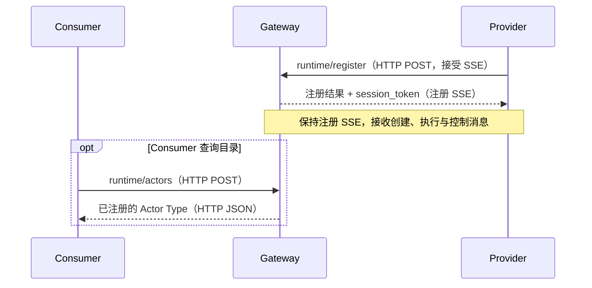
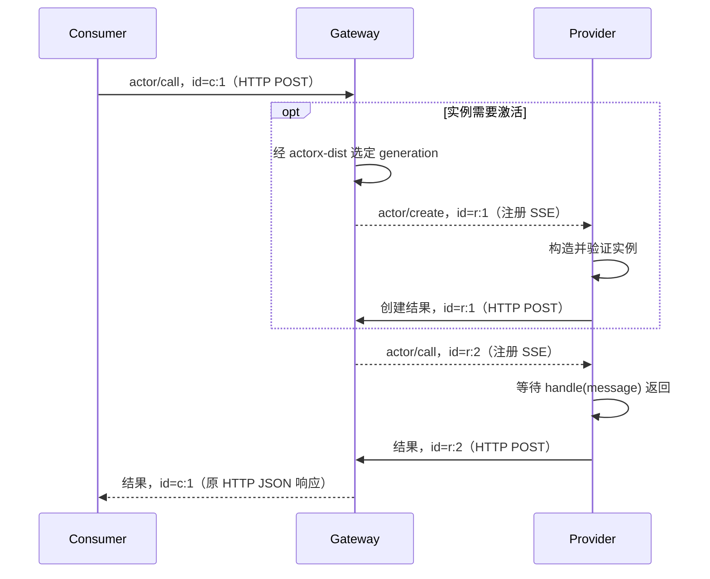
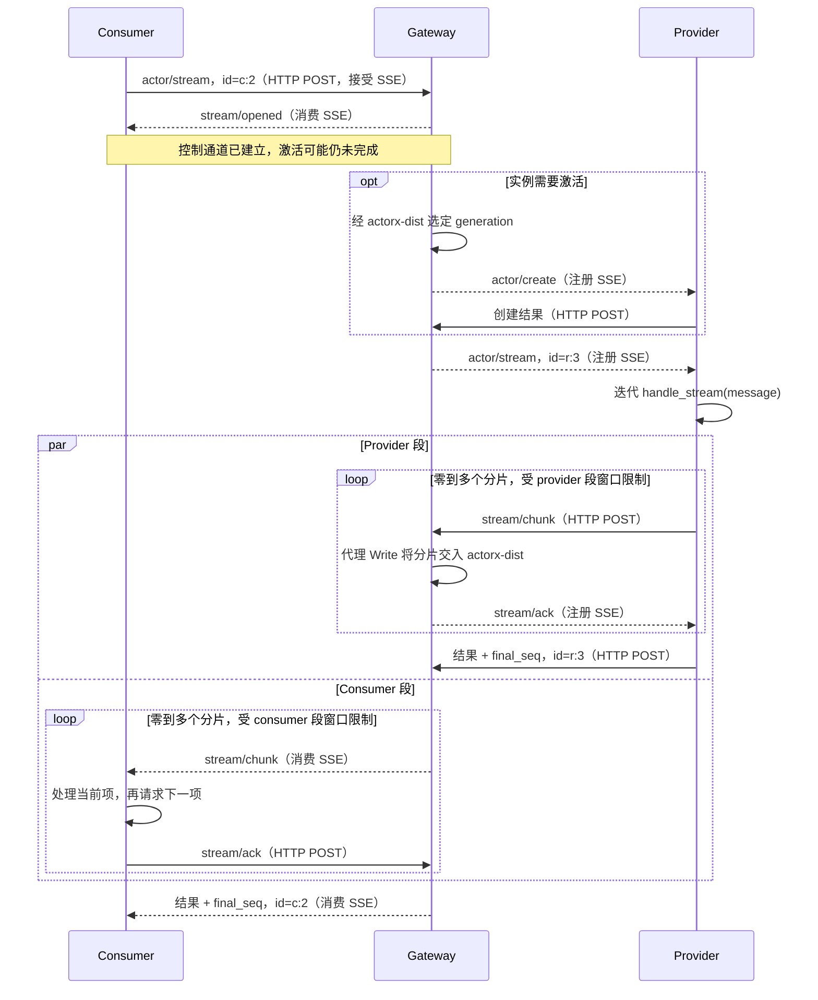
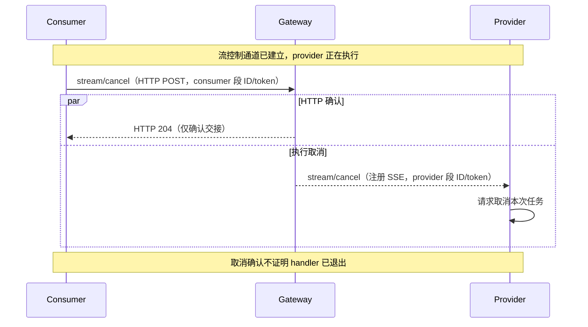

# Remote 协议

[English](protocol.md) | 中文

`actorx.remote/v1` 通过 HTTP/SSE 连接 consumer、gateway 和 provider。本文是 Call 与 Stream 的完整 wire 说明；使用 Go/Python SDK 时，消息编解码、版本 Header、流控和响应关联由 SDK 管理。首次使用可先运行 [Counter](../examples/counter/README.zh.md) 或 [Chat](../examples/chat/README.zh.md)，再查阅 [SDK 指南](../sdk/python/README.zh.md)。

## 共同模型

Provider 注册 Actor。每个实例由 Type/ID/generation 标识，并拥有独立生命周期；Call、Stream 是它的两种操作。

| | Call | Stream |
| --- | --- | --- |
| Consumer API | `await addr.call(message)` | `async with addr.stream(message) as chunks` |
| Provider 方法 | `handle(message)`，返回可 await 的单个 JSON 结果 | `handle_stream(message)`，直接返回异步迭代器 |
| 业务输出 | 一个 JSON 值 | 零到多个 JSON 项，加一个明确终态 |
| Consumer 响应 | HTTP JSON | HTTP SSE |

对象可实现一种或两种方法；两种操作共享实例状态并串行执行。缺失所请求的方法返回 1013；方法进入后抛异常或返回形态错误为 1000。SDK 不自动转换操作。

两端都主动连接 gateway。Provider 保持注册 SSE 接收创建、执行和流控制消息，通过独立 POST 返回结果或分片，无需监听入站端口。

流程与报文：[注册与发现](#注册与发现)、[Call](#call-过程)、[Stream](#stream-过程)、[提前取消](#streamcancel提前取消)。图中省略 provider POST 的会话 Header 和 HTTP 204 交接确认，明确标注的除外。

## 传输与消息

### HTTP 与鉴权

所有消息使用 `POST /runtime/rpc`，携带：

```http
Authorization: Bearer <api-key>
Content-Type: application/json
X-Actorx-Remote-Protocol: actorx.remote/v1
```

SDK 自动携带版本 Header 并校验注册结果。Gateway 在鉴权后、读取 body 和分派前要求恰好一个匹配的版本 Header；缺失、不匹配、空值或歧义值均返回 HTTP 400。

| POST 内容 | 附加 Header | 正常响应 |
| --- | --- | --- |
| 注册 `runtime/register` | `Accept: text/event-stream, application/json` | 200 SSE：注册结果，然后是该注册的创建、执行、credit/cancel 消息 |
| 消费 `actor/stream` | 同上 | 200 SSE：stream/opened、分片、最终 result/error |
| Call、Actor 目录、普通请求 batch | `Accept: application/json` | 200 JSON result/error 或响应数组 |
| Provider 的结果、错误、chunk | `X-Actorx-Remote-Session: <session_token>` | 校验并交接后返回 204 |
| Consumer 的 credit/cancel | 无会话 Header；每次单条通知 POST | 校验并交接后返回 204 |

注册和消费 Stream 都要求**单条有 ID 请求**并接受 SSE。batch/notification 不建立流：有 ID 请求返回 1008，通知不产生 RPC 响应。建立 SSE 前的业务拒绝使用 200 JSON RPC error，因此应同时接受 JSON；响应格式不可接受时返回 406。

每个 SSE 帧为 `data: <一条单行 JSON-RPC 消息>` 加一个空行，并立即 flush。SSE event/id 不替代 RPC method/id。**HTTP 200、POST 204 和 SSE EOF 均不代表业务成功**；204 只证明本次交接。

每个 POST 都先校验共享静态 API Key，再读取 body、查找会话或执行 Actor 工作。不区分 consumer/provider 权限，无 Type ACL 或租户隔离。缺 Key 的 401 含 `WWW-Authenticate: Bearer realm="actorx-remote"`；错误 Key 另含 `error="invalid_token"`。重复/歧义 Authorization 被拒绝，Key 使用常量时间比较。

通过受信环境配置至少 32 随机字节生成的 Key；Key/token 不放 URL 或日志。本机演示以外使用 HTTPS 并校验证书，保护 TLS 终止后的链路；SDK 不跟随重定向。`session_token` 仅关联一次注册，不能代替 API Key，也不是幂等键。Provider 上行消息须带会话 Header；其他请求/通知不得携带它。

### JSON-RPC

信封使用 JSON-RPC `2.0`。请求含 `method`、对象形式的 `params` 和 `id`；通知省略 `id`；响应回显 ID，且只含 `result`、`error` 中的一种，`result: null` 也算结果。Actor 目录允许省略 params。方法按完整斜杠名称匹配，无点号别名；未知方法或方向错误为 -32601。

Consumer/SDK 生成非空字符串 ID；consumer 请求也接受数字和 null，并保留其类型与精度。`id: null` 是有 ID 请求。ID 只关联本通信段的请求与响应，不提供业务去重。Provider 响应还须匹配注册和完整地址；坏响应或迟到响应不能消耗合法 pending 请求。

Gateway → provider 的请求 ID 为 `r:<n>`：n 是 1 到 2^53−1 的十进制整数，无前导零。每个注册会话的 create/call/stream 共用从 1 开始的计数器，按入队顺序递增，允许跳号和乱序完成。Provider 仅保存已接收的最大序号；非法、重复或倒退 ID 为协议错误并结束会话。序号耗尽时拒绝新请求，不回绕。通知不推进计数器；流控制的 request_id 引用原请求。

持有注册 SSE 的 Gateway 副本拥有该会话，注册、pending 和流状态均在本机内存中；相关 POST 须路由回所属副本。新注册使用新 session_token 并重新计数，副本间无需共享计数器。

JSON 必须是 UTF-8，不接受重复键或 NaN/Infinity。忽略未知信封字段，拒绝未知方法参数（-32602）。业务 `input`/`value` 必填但允许 null，内部内容由应用定义；数字不在边界处舍入。

普通请求 batch 最多八项，在同一 HTTP 预算内顺序执行，不是事务；通知无响应，全通知文档返回 204。空 batch/非法元素遵循 JSON-RPC 错误规则。Provider 响应、chunk 和流控制均使用单条 POST；batch 混入 provider 响应会在分派前整体拒绝。Go/Python SDK 不提供 batch API。

## 身份、注册与方法

```json
{
  "version": 1,
  "type": "demo.chat",
  "id": "session-42",
  "generation": "AAAAAAAAAAAAAAAAAAAAAA"
}
```

`type` 标识 Actor 类型，`id` 标识业务实例。首次 `actor/call` 或 `actor/stream` 可以省略 generation；gateway 经 actorx-dist 选代。generation 是 16 字节的规范无填充 base64url 值。Provider 的创建/执行消息必须带完整地址。

SDK 从成功结果、有效错误地址或 Stream 首项保存 generation；后续操作固定该代次，不因错误自动换代。stream/opened 不带地址，只建立控制通道；空流在终态提供地址。可能已受理但缺少可信选代证据时，句柄进入不明状态，后续操作抛 `AddressUncertainError`。显式取得新句柄不等于对之前的工作去重；鉴权/参数拒绝和确定的建连失败不污染句柄。

以下表格列出所有方法。除明确标记可选的字段外，params 字段均必填；“固定地址”含 generation。`window` 固定为 `{"items":4,"bytes":32768}`。

| 方法 | 消息 | params | 成功 result |
| --- | --- | --- | --- |
| `runtime/register` | 请求 | type；可选 description，默认空 | protocol、type、session_token |
| `runtime/actors` | 请求 | 空对象，可省略 | actors：包含 type、description、protocol 的对象数组 |
| `actor/call` | 请求 | address、input；可选 deadline_unix_ms | 固定 address、value |
| `actor/create` | 请求 | 固定 address、deadline_unix_ms | 相同 address |
| `actor/stream` | 请求 | Call 共同字段；provider 请求另须 stream_token、window | 固定 address、final_seq |
| `stream/opened` | 通知 | request_id、stream_token、window | 无 |
| `stream/chunk` | 通知 | request_id、stream_token、固定 address、seq、value | 无 |
| `stream/ack` | 通知 | request_id、stream_token、ack_seq | 无 |
| `stream/cancel` | 通知 | request_id、stream_token | 无 |

Gateway 按需选代，以独立请求 ID 转交固定地址和既定绝对期限。Provider 的 Call/Stream 必须带 generation 和显式期限，Stream 另需预置 `stream_token`、`window`；consumer 拒绝这两个控制字段，可省略 generation 和期限。

以下 JSON 为阅读方便采用缩进；实际 SSE 中每条消息占一行。地址、token 和期限为示意值，实际由运行时选定或计算。

## 注册与发现

Provider 先注册 Type 并保持返回的 SSE，后续 POST 使用注册结果中的会话 token。Consumer 可按需查询目录，Call/Stream 前不强制查询。



注册只建立会话，不构造实例、探测方法或保证创建成功；首次 Call/Stream 才按需创建。

目录只是当前注册快照，不枚举运行实例、不预留容量或保证后续可用；条目的 protocol 不承诺业务方法支持。

v1 注册 params/result 和 Actor 条目均无 `capabilities`；旧注册参数即使为 false、null 或空对象也被拒绝，SDK 同样拒绝含该字段的注册结果。

### runtime/register：注册 Actor

Provider → gateway，单条 HTTP POST，接受 SSE：

```json
{
  "jsonrpc": "2.0",
  "id": "p:1",
  "method": "runtime/register",
  "params": {
    "type": "demo.chat"
  }
}
```

Gateway → provider，注册 SSE 的首帧返回 protocol、Type 和会话 token：

```json
{
  "jsonrpc": "2.0",
  "id": "p:1",
  "result": {
    "protocol": "actorx.remote/v1",
    "type": "demo.chat",
    "session_token": "<session_token>"
  }
}
```

### runtime/actors：列出已注册的 Actor 类型

Consumer → gateway，普通 HTTP POST；`params` 可省略或为 `{}`：

```json
{
  "jsonrpc": "2.0",
  "id": "list:1",
  "method": "runtime/actors"
}
```

Gateway 在原 HTTP 响应中返回已注册的 Remote Actor 类型列表：

```json
{
  "jsonrpc": "2.0",
  "id": "list:1",
  "result": {
    "actors": [
      {
        "type": "demo.chat",
        "description": "Chat provider",
        "protocol": "actorx.remote/v1"
      }
    ]
  }
}
```

每个 Type 只出现一次，列表按 Type 排序。同一 Type 的 provider 提供不同描述时，`description` 为空。

列表可能不完整，列出的 Type 也不保证后续调用成功。当前尚不支持跨 Gateway 调用。

发现限额导致无法返回完整列表时，查询返回 1001/full；完整响应超过 8 KiB 时返回 HTTP 413。出错时不返回部分列表。

## Call 过程

Consumer 发起 Call，在原 HTTP 请求上等待结果；需要激活时，gateway 先选代、创建实例，再执行调用。



已有就绪实例跳过 `actor/create`；创建失败则不执行调用。Stream 首次激活也使用这个方法。

### actor/call：发起调用

Consumer → gateway，普通 HTTP POST；本例省略 generation：

```json
{
  "jsonrpc": "2.0",
  "id": "c:1",
  "method": "actor/call",
  "params": {
    "address": {
      "version": 1,
      "type": "demo.chat",
      "id": "session-42"
    },
    "input": {
      "text": "hello"
    }
  }
}
```

### actor/create：按需创建实例

Gateway → provider，经既有注册 SSE 发送选定的完整地址和创建期限：

```json
{
  "jsonrpc": "2.0",
  "id": "r:1",
  "method": "actor/create",
  "params": {
    "address": {
      "version": 1,
      "type": "demo.chat",
      "id": "session-42",
      "generation": "AAAAAAAAAAAAAAAAAAAAAA"
    },
    "deadline_unix_ms": 1890000000000
  }
}
```

Provider 创建并验证真实对象，再通过 HTTP POST 回答。同一完整身份的重复 create 复用已有对象：

```json
{
  "jsonrpc": "2.0",
  "id": "r:1",
  "result": {
    "address": {
      "version": 1,
      "type": "demo.chat",
      "id": "session-42",
      "generation": "AAAAAAAAAAAAAAAAAAAAAA"
    }
  }
}
```

### actor/call：执行 Call

Gateway → provider，经注册 SSE 下发输入、固定地址和剩余期限：

```json
{
  "jsonrpc": "2.0",
  "id": "r:2",
  "method": "actor/call",
  "params": {
    "address": {
      "version": 1,
      "type": "demo.chat",
      "id": "session-42",
      "generation": "AAAAAAAAAAAAAAAAAAAAAA"
    },
    "input": {
      "text": "hello"
    },
    "deadline_unix_ms": 1890000000000
  }
}
```

Provider 调用 `handle(message)`，等待一个 JSON 值，通过 HTTP POST 返回：

```json
{
  "jsonrpc": "2.0",
  "id": "r:2",
  "result": {
    "address": {
      "version": 1,
      "type": "demo.chat",
      "id": "session-42",
      "generation": "AAAAAAAAAAAAAAAAAAAAAA"
    },
    "value": {
      "text": "complete answer"
    }
  }
}
```

Gateway 在原 HTTP 响应中返回相同的 `result`，将响应 ID 改为 consumer 的 `"c:1"`。

Call 成功证明本次 handler 已返回，不保证额外后台工作已结束。业务失败返回 `error`，见[错误](#错误)。

## Stream 过程

Consumer 通过 SSE 打开 Stream；gateway 先建立控制通道，再按需激活实例并执行。以下方法示例使用已选定 generation 的一项流。



每次 Stream 产生零到多个 chunk，以及一个回答原请求的终态 result/error。两段独立推进，完成条件见[流控与终态](#流控与终态)。

Gateway 映射两段独立的 RPC ID、流 token、序号与 credit 账本。流 token 是 32 随机字节的规范无填充 base64url 编码；consumer 不会获得 provider 的会话 token 或流 token。示例取值：

| 通信段 | 原请求 ID | stream_token |
| --- | --- | --- |
| consumer ↔ gateway | `c:2` | `AAAAAAAAAAAAAAAAAAAAAAAAAAAAAAAAAAAAAAAAAAA` |
| gateway ↔ provider | `r:3` | `AQEBAQEBAQEBAQEBAQEBAQEBAQEBAQEBAQEBAQEBAQE` |

### actor/stream：发起 Stream

Consumer → gateway，单条 HTTP POST，接受 SSE；params 与 Call 相同：

```json
{
  "jsonrpc": "2.0",
  "id": "c:2",
  "method": "actor/stream",
  "params": {
    "address": {
      "version": 1,
      "type": "demo.chat",
      "id": "session-42",
      "generation": "AAAAAAAAAAAAAAAAAAAAAA"
    },
    "input": {
      "text": "hello"
    }
  }
}
```

### stream/opened：建立控制通道

Gateway → consumer，原请求的 SSE 首条通知，给出 consumer 段 token 和固定窗口：

```json
{
  "jsonrpc": "2.0",
  "method": "stream/opened",
  "params": {
    "request_id": "c:2",
    "stream_token": "AAAAAAAAAAAAAAAAAAAAAAAAAAAAAAAAAAAAAAAAAAA",
    "window": {
      "items": 4,
      "bytes": 32768
    }
  }
}
```

它不含地址，不表示激活或执行已成功；首次选代可能仍在进行。

### actor/stream：执行 Stream

Gateway → provider，经注册 SSE 下发另一个 RPC ID、provider 段 token、完整地址和期限：

```json
{
  "jsonrpc": "2.0",
  "id": "r:3",
  "method": "actor/stream",
  "params": {
    "address": {
      "version": 1,
      "type": "demo.chat",
      "id": "session-42",
      "generation": "AAAAAAAAAAAAAAAAAAAAAA"
    },
    "input": {
      "text": "hello"
    },
    "deadline_unix_ms": 1890000000000,
    "stream_token": "AQEBAQEBAQEBAQEBAQEBAQEBAQEBAQEBAQEBAQEBAQE",
    "window": {
      "items": 4,
      "bytes": 32768
    }
  }
}
```

Provider 调用 `handle_stream(message)` 并迭代输出。多个实例的 create、call、stream 和控制消息可在同一注册 SSE 上交错。

### stream/chunk：发送分片

Provider → gateway，带会话 Header 的单条通知 POST；`request_id` 引用 provider 段的执行请求：

```json
{
  "jsonrpc": "2.0",
  "method": "stream/chunk",
  "params": {
    "request_id": "r:3",
    "stream_token": "AQEBAQEBAQEBAQEBAQEBAQEBAQEBAQEBAQEBAQEBAQE",
    "address": {
      "version": 1,
      "type": "demo.chat",
      "id": "session-42",
      "generation": "AAAAAAAAAAAAAAAAAAAAAA"
    },
    "seq": 1,
    "value": {
      "text": "first fragment"
    }
  }
}
```

Gateway 校验后，以 consumer 段的 ID/token 和独立序号，经 consumer SSE 转发同一个 value；本例两段 seq 均为 1。

### stream/ack：确认消费

Consumer → gateway，单条通知 POST，不带会话 Header：

```json
{
  "jsonrpc": "2.0",
  "method": "stream/ack",
  "params": {
    "request_id": "c:2",
    "stream_token": "AAAAAAAAAAAAAAAAAAAAAAAAAAAAAAAAAAAAAAAAAAA",
    "ack_seq": 1
  }
}
```

Gateway → provider 的 ack 使用 provider 段 ID/token，经注册 SSE 下发；两段确认独立，时机见[流控与终态](#流控与终态)。

### 最终响应：结束 Stream

迭代正常结束后，provider 通过带会话 Header 的 POST 回答 `actor/stream`；终态是响应，没有 method：

```json
{
  "jsonrpc": "2.0",
  "id": "r:3",
  "result": {
    "address": {
      "version": 1,
      "type": "demo.chat",
      "id": "session-42",
      "generation": "AAAAAAAAAAAAAAAAAAAAAA"
    },
    "final_seq": 1
  }
}
```

Gateway 等 consumer 确认本段全部项后，经原 SSE 返回 ID 为 `"c:2"` 的成功响应；本例 `result` 与上面相同。

空流、部分失败和完成条件见[流控与终态](#流控与终态)。

### stream/cancel：提前取消

控制通道建立后，consumer 可请求取消本次执行：



取消仅影响本次 Stream，保留共享 Actor/注册。HTTP 204 与取消传播独立，均不证明 handler 已退出；迟到取消不改写确定终态。原 Stream 按[终态与错误规则](#流控与终态)结清。

Consumer → gateway，单条通知 POST，不带会话 Header：

```json
{
  "jsonrpc": "2.0",
  "method": "stream/cancel",
  "params": {
    "request_id": "c:2",
    "stream_token": "AAAAAAAAAAAAAAAAAAAAAAAAAAAAAAAAAAAAAAAAAAA"
  }
}
```

Gateway 通过注册 SSE，用 provider 段 ID/token 转发取消请求。

### 流控与终态

`request_id` 引用本段原请求 ID，保留字符串/数字/null 类型。`seq` 从 1 连续递增，最大 2^53−1；`ack_seq`、`final_seq` 范围为 0 到 2^53−1。所有分片和终态地址须匹配固定身份。

每段固定窗口为四项/32 KiB，不协商其他值。按完整 JSON-RPC chunk 的实际 UTF-8 字节计数，不含 SSE 包装；排队与正在处理项均占额度。累计 ack_seq 只释放本段账本中的连续项，重复/倒退确认不增加额度，超前确认被拒绝。

| 通信段 | 发送 credit 的时刻 |
| --- | --- |
| provider → gateway | 代理 StreamReply.Write 成功交入有界 actorx-dist Stream 后 |
| gateway → consumer | 用户处理完当前项，请求下一项时 |

Provider credit 不证明最终 consumer 已消费。Gateway 回调等待 consumer credit 才返回，慢消费经 actorx-dist 窗口传至 provider。上行 POST 只做有界交接，不等待整条消费链；provider 须等每次 POST 的 204 后再发下一项或终态，204 不代替 credit。

控制与终态使用数据窗口外的有界预留。处理最后一项后仍须请求下一项，先确认该项再等待结束。

三个完成事实分别判断：

- **成功终态**：`final_seq: N` 表示本段正常产出 N 项，之后不再输出 chunk；N=0 是合法空流。终态可先于全部 ack 到达。
- **本地成功**：合法成功终态已通过校验，连续 N 项均完成本地交付责任（应用消费或有界转交），不能跳过排队项。本地消费失败保留为本地失败，不抹去确定的产出结果。
- **账本回收**：发送端保留未确认账本，直至全部 ack、原期限到达或连接/会话关闭。

错误在 data 中附已知 address 和本段 final_seq，可以丢弃尚未完成本地交付的排队项，已交给用户的部分结果不回滚。

缺终态、断线、缺块或序号/身份矛盾，且业务可能已执行时，为 1004 `outcome_unknown`。最后 credit 的传输失败不改写已校验且完成本地交付的成功证据。

## 期限与取消

`deadline_unix_ms` 是 UTC Unix 毫秒整数；省略与零不同，零已过期。各阶段沿用剩余期限，不为响应或重试重新计时。

| 操作 | 预算 |
| --- | --- |
| Call | 默认五秒，与显式 deadline、父 context 取最早者；显式值不能延长五秒上限 |
| Stream | 默认五秒；显式 deadline 至多入口后 60 秒，并受父 context 限制 |
| 共享激活的 create | 独立三秒上限，受生命周期期限限制 |
| 注册 | 五秒安装预算；成功后转为长连接 |
| SSE 帧写入 | 每帧至多五秒，Stream 还受本次总期限限制 |

Python 的 Stream `timeout` 接受 (0, 60] 秒，使用单调时钟约束等待；chunk/credit 不续期。handler 启动前过期为 1005，启动后超时且缺少可信终态为 1004。

Call 暂无远端取消方法。SDK 在用户任务实际退出前保留实例锁和执行槽，避免同实例操作重叠；超时、取消或断线不证明外部副作用已结束。

Python 应使用 `async with` 和 `async for` 消费，提前 break 也须退出 context 或显式 `await chunks.aclose()`；Runtime 关闭同样负责回收。Provider 断线会撤销注册、唤醒 pending 请求，不自动恢复。详细所有权与关闭顺序见[运行模型](runtime.zh.md#断线与关闭)。

## 错误

### HTTP 拒绝

| 状态 | 含义 |
| --- | --- |
| 400 | 协议/会话 Header 非法或歧义；provider 消息或流控制损坏 |
| 401 | API Key 缺失、错误或歧义 |
| 403 | 会话/流 token 无效或已关闭；provider 上行缺会话 Header |
| 405 | 非 POST 方法 |
| 406 | 响应格式不可接受 |
| 409 | 请求未知/已结清、关联或地址不匹配、credit 超前 |
| 413 | body、batch 项数或编码响应超限 |
| 415 | Content-Type 不是 application/json |

这些情况直接返回 HTTP 状态，不生成 RPC error。非法请求 JSON、RPC 信封或业务失败使用下述 RPC 错误；业务错误仍为 HTTP 200 JSON 或 SSE 终态，不转成 502/504。SSE 无法设置写期限时可能返回 500。

### RPC 错误

标准错误为 -32700 `parse_error`、-32600 `invalid_request`、-32601 `method_not_found`、-32602 `invalid_params`、-32603 `internal_error`。应用错误如下：

| code | error.data.kind | 含义 |
| --- | --- | --- |
| 1000 | remote_error | 实例创建失败、handler 异常、无有效方法或返回形态非法 |
| 1001 | full | 明确容量拒绝 |
| 1002 | actor_unavailable | 合法地址无法解析或无可用目标，业务 handler 尚未进入 |
| 1003 | activation_unknown | 激活或选代证据不明 |
| 1004 | outcome_unknown | 可能已执行，缺少可信终态 |
| 1005 | deadline_exceeded | 确定的期限失败 |
| 1006 | stopped | 确定的停止/关闭失败 |
| 1007 | registration_conflict | 本地同 Type 已注册或正在撤销 |
| 1008 | transport_mode | 当前通道不满足单条请求、SSE 或控制上下文建立条件 |
| 1009 | canceled | 不含不明分类的取消 |
| 1010 | owner_unavailable | actorx-dist owner 不可达，不自动接管 |
| 1011 | contract | actorx-dist DTO/Type 契约不匹配 |
| 1012 | protocol | 内部协议/接线失败 |
| 1013 | unsupported_operation | 实例缺少所请求操作的可调用方法 |

错误回显原请求 ID，无法确定时为 null。应用错误含 `data.kind`，已知时含完整 `data.address`；Stream 错误另含本段 `final_seq`：

```json
{
  "jsonrpc": "2.0",
  "id": "c:2",
  "error": {
    "code": 1013,
    "message": "unsupported_operation",
    "data": {
      "kind": "unsupported_operation",
      "address": {
        "version": 1,
        "type": "demo.chat",
        "id": "session-42",
        "generation": "AAAAAAAAAAAAAAAAAAAAAA"
      },
      "final_seq": 0
    }
  }
}
```

1013 必须带完整地址，Stream 必须为零项且 `final_seq: 0`。它证明所请求的方法未进入，但可能已构造对象。Python 抛 `UnsupportedOperationError` 并保存 generation，同一 Addr 可继续调用另一种受支持操作；缺地址或矛盾终态按 1004 处理。

参数结构或值非法使用 -32602；1002/1008 用于合法请求因地址/通道能力而在 handler 进入前被拒绝。已建立 Stream 的这两类拒绝必须无 chunk 且 `final_seq: 0`；建流前 JSON 拒绝可省略 final_seq。矛盾的终态证据按 1004 处理。

经校验的 provider 错误 1000/1001/1002/1004/1005/1008/1009/1013 保留分类，其他合法应用错误归一为 1000；已知出站方法的标准 RPC 错误转为 1012。已知 kind/code 必须一致。异常类型、堆栈和任意 provider 扩展数据不穿过 actorx-dist，诊断最多 512 UTF-8 字节。

确定的 provider 失败优先于稍后的停止/取消；无确定终态时按 outcome_unknown → activation_unknown → 具体框架错误分类。用户本地消费异常保留为本地失败。

## 限制与兼容

| 项目 | 上限 |
| --- | --- |
| 单次请求 body / 单条编码消息（含信封） | 8 KiB |
| 请求 batch | 至多八项，body 仍限 8 KiB |
| 编码 batch 响应 | 64 KiB |
| JSON 嵌套 | 64 层 |
| 每段未确认 chunk | 四项 / 32 KiB |

当前未发布的 `actorx.remote/v1` 含不兼容调整，gateway 和 SDK 须配套升级。Stream 消息改用 `stream/opened`、`stream/chunk`、`stream/ack`、`stream/cancel`；原有的 `actor/stream_open`、`actor/chunk`、`actor/credit`、`actor/cancel` 不再作为 wire 别名接受。消息改名不改变其消息体、流控、取消及 HTTP 状态处理。

执行容量、对象数量与队列限制见[运行模型](runtime.zh.md#资源限制)。address.version=1、jsonrpc="2.0" 和 actorx.remote/v1 各自描述不同层，互不联动。v1 固定提供两种通信操作，不协商 capabilities；SDK 删除旧 `stream=True` 参数。升级 gateway/SDK 不会清除已发布的 actorx-dist Type 契约，旧 Type 的处理见[迁移说明](runtime.zh.md#协议与-type-迁移)。Send、WebSocket、自动重连/重试和续读暂未实现。

实现参考：[基础 DTO](../protocol/messages.go)、[Stream DTO](../protocol/stream.go)、[信封与方法校验](../protocol/rpc.go)、[HTTP 接入](../http/handler.go)。Go/Python 共用 [v1 固定报文](../protocol/testdata/v1.json)；内部 DTO 与代理接线见[运行模型](runtime.zh.md#go-桥接)。

- [Go SDK](../sdk/go/README.zh.md) / [Python SDK](../sdk/python/README.zh.md)
